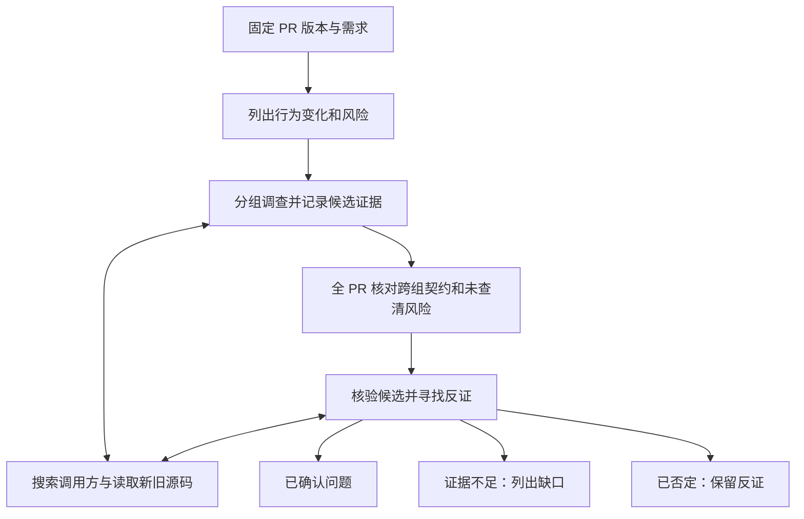

# PR 评审能力迭代调研：减少漏报、加深分析

日期：2026-10-15。代码基线：`f58a8f9e94b3c6a6ffd9fd17e85ec6318670fd61`（Decision 1.2.0）。

用户明确的问题是「漏掉真正的 bug，分析不够深入」。本轮检查实现、测试、已有调研和外部一手资料，形成待实施建议；没有修改评审行为，也没有运行真实 PR 的模型对比实验。下文区分已核实的机制与尚待测量的质量影响。

## 1. 建议

下一轮优先补齐 **发现相关代码 → 沿调用链取证 → 核验时保留证据 → 用真实缺陷衡量漏报**。

当前已有分组、补读源码、独立核验和双审查者。主要缺口集中在：源码路径需要模型自己猜；核验缺少源码证据；深度模式没有增加跨文件缺陷审查；固定轮数和偏保守的提示词容易提前结束调查。建议先做评测基线、取证工具和核验改造，再增加按风险分配的深入调查。

模型能力仍然影响上限，但仅更换模型无法补出工具没有提供的仓库搜索能力。应在同一回放集上分别测量模型变化与流程变化的贡献。

## 2. 当前已经具备的能力

与 [9 月 30 日调研](<../docs/pr-review-research-2026-09-30.md>) 相比，以下能力已落地，本轮不把它们再次列成新功能：

- 按模型类别给预算，多文件组成一组，大文件按 hunk 切分；为变更补充少量源码上下文。
- 大 PR 先生成梗概，远端模型最多三组并行；允许读取别组 diff 和指定路径的源码。
- 深度评审同时运行缺陷审查者、规则与决策审查者。
- 候选去重后独立核验，被过滤的候选仍可查看；核验调用失败时保留原问题并提示。
- 核验支持多轮补读 diff，长行可以接着读；近期还修复了上下文预算、来源错误和提交版本核对问题。
- 已有评论、采纳与不采纳反馈、决策作用域、历史问题复核、成本统计和未完成提示。

这些是可靠性基础，值得保留。下面讨论的是 bug 发现能力的下一步。

## 3. 代码中可以确认的薄弱环节

| 优先级 | 已核实的现状 | 对漏报的可能影响 | 代码证据 |
|---|---|---|---|
| 高 | 评审动作只有 `read_diff`、`read_file`、`search_decisions`、`finish_review`。没有仓库文件查找、源码文本搜索或引用搜索。 | 能读已知路径，但难以发现未改动的调用方、实际校验入口、配置和测试；跨文件调查依赖模型猜路径。 | [动作协议及工具](<../apps/desktop/src/main/pr-review-service.ts#L40>) |
| 高 | `read_file` 只读源提交，每次 80 行，再截到 6000 字符。底层已经支持读取 old/new 完整文件，但未向评审动作开放旧版读取。 | 不方便核对旧行为、完整函数、远处的错误处理及调用条件。 | [评审读取](<../apps/desktop/src/main/pr-review-service.ts#L1660>)、[平台已有能力](<../apps/desktop/src/main/pr-platform-client.ts#L654>) |
| 高 | 核验起始材料主要是候选所在文件的 diff、文字说明及规则/决策；补读仍从 diff map 取内容。评审员工具读到的源码没有作为可定位的证据传入核验。 | 发现阶段读过的调用方或 guard，到核验阶段可能不可见；跨文件候选可能被当作证据不足。核验已支持多轮，但材料范围仍窄。 | [核验输入](<../apps/desktop/src/main/pr-review-service.ts#L1182>)、[补读实现](<../apps/desktop/src/main/pr-review-service.ts#L312>) |
| 高 | 核验门槛为 80；评分说明把「很可能是真问题、实际会遇到、影响功能」放在 75，把频率和重要性混入置信度。 | 一个正确但低频的 bug 可能被压低分数。这里只能确认规则存在，尚不能断言实际误杀了多少条。 | [评分标准](<../apps/desktop/src/main/pr-review-service.ts#L283>) |
| 高 | 发现和核验提示词均排除「编译器、类型检查、lint 或测试会发现的问题」，但流程没有取得 CI 检查结论，也不执行测试。 | 把「理论上能被测试发现」当作已经被覆盖；失败路径和业务回归也可能因此少报。 | [发现提示词](<../apps/desktop/src/main/pr-review-service.ts#L130>)、[核验提示词](<../apps/desktop/src/main/pr-review-service.ts#L291>) |
| 中高 | 每组主循环最多 6 次模型调用，重试占用次数，最后一次必须结束；后续还有一次性兜底，但不能继续使用工具。 | 读取多层调用链时调查空间有限；工具错误和重复读取会进一步触发收尾。问题在有效调查预算，不只是总调用次数。 | [上限](<../packages/protocol/src/pr-review.ts#L6>)、[调用与收尾](<../apps/desktop/src/main/pr-review-service.ts#L1783>) |
| 中高 | 深度模式分工为 bugs / rules；并行分组不共享调查结论。分组结束后做去重与候选核验，没有主动寻找遗漏的全 PR 综合审查。 | 多位审查者未必带来更多行为分析；分散在不同组的生产者/消费者契约可能没有被串起来。核验也无法补出从未生成的候选。 | [角色](<../apps/desktop/src/main/pr-review-service.ts#L141>)、[汇总](<../apps/desktop/src/main/pr-review-service.ts#L1440>) |
| 中 | findings 必须落在已读的变更行；收尾时不能落点的候选最多就近挪 5 行，否则被舍弃。 | 真实缺陷的症状常在未修改的调用方；若没有要求模型回溯到引入原因，定位失败可能变成候选丢失。 | [placed](<../apps/desktop/src/main/pr-review-service.ts#L1521>) |

还有两个次级限制：分组主要按路径和篇幅，函数上下文只是上方 3 行、额外回看最多 10 行、下方 1 行；仓库规范主要读取根目录及其显式导入。这些都可以逐步加强，但当前优先级低于源码搜索和核验证据。

CLI 模型也受同样的取证边界限制。当前 Codex 适配器在临时目录运行并关闭 shell 等能力；Claude Code 适配器把原生 tools 置空。它们承担结构化推理，评审工具由 Decision 提供。因此选择 CLI 后端，不等于获得该 CLI 在完整仓库中的原生评审能力。[Codex 适配器](<../apps/desktop/src/main/model/adapters/codex-cli-adapter.ts#L360>)、[Claude Code 适配器](<../apps/desktop/src/main/model/adapters/claude-code-cli-adapter.ts#L308>)。

### 一个用来解释缺口的例子

假设 PR 把 `loadAccount()` 的失败行为从抛异常改为返回 `null`，某个未修改的调用方仍直接访问 `account.id`。这是构造例子，不是本轮发现的仓库缺陷。

充分的调查需要：搜索所有调用方 → 区分已有 null guard 的路径 → 找到一个真实入口 → 对照旧版确认这是新增回归 → 把报告锚到改变返回行为的变更行，并引用调用方作为证据。

当前流程可以做到其中部分步骤，但缺少调用方发现能力；即使评审员猜到路径并读取，核验员也不一定拿到相同的源码证据。增加一位只查规范的审查者不能补齐这条链路。

## 4. 外部一手资料给出的方向

### 动态调查和工具设计

Cursor 在 2026-01-15 的工程文章中报告：Bugbot 改为能按需取上下文的 agent 后，遇到了过度谨慎的问题，随后调整提示词鼓励调查可疑模式；工具接口的调整也显著影响效果。文章同时介绍使用真实 diff、人工标注缺陷的离线评测。可迁移的是「让模型取得证据，并用基准检查改动」，效果数字不能直接套到 Decision。[Cursor：Building a better Bugbot](https://cursor.com/blog/building-bugbot)

### 专项审查与行为核验

Anthropic 的托管 Code Review 文档描述了多个专项 agent 在完整代码库上下文中检查变更，并针对实际代码行为核验候选。这里的重点是审查视角和证据能力；它与本地开源 code-review 插件不是同一个实现，不能用插件的固定规则代表托管服务。[Anthropic Code Review 文档](https://code.claude.com/docs/en/code-review)

### 风险计划和调查中的候选记录

GitHub 在 2026-03-05 的工程介绍中说明：长 PR 使用显式评审计划，调查时及时记录发现，并读取关联 issue/PR 理解需求。这支持把「整个 PR 的梗概」进一步变成可核对的行为风险与调查任务，也提示要保存中途证据，避免只在收尾时总结。[GitHub：60 million Copilot code reviews and counting](https://github.blog/ai-and-ml/github-copilot/60-million-copilot-code-reviews-and-counting/)

### 有针对性的执行验证

Greptile 在 2026-06-17 的 TREX 工程复盘中说明，独立于评审上下文生成测试曾偏离目标；后来让执行代理继承评审证据，并围绕具体问题调查、返回脚本和日志等产物。可迁移的是定向验证及可检查的执行证据，其内部效果数据不构成 Decision 的收益承诺。[Greptile：Building TREX](https://www.greptile.com/blog/trex-code-execution)

### 公开基准的适用范围

SWE-PRBench v1 使用固定上下文和独立 API 请求，三种输入约为 2000–2500 token，评价主要依赖 LLM judge。其上下文实验可提醒我们做消融对比，却不能证明动态仓库检索无用，也不能直接给端到端 PR agent 排名。对 Decision 更有价值的是固定输入、按缺陷类型评估和保留来源的方法。[SWE-PRBench v1，§4–5](https://arxiv.org/html/2603.26130v1)

### 对 9 月 30 日材料的修正

本次读取的 Anthropic 开源 code-review 命令已经是四位并行审查者加逐条验证，其中一位仅看 diff，且提示词排除了依赖特定输入/状态的潜在问题。它与旧文记下的流程不同；旧文中的 80 分门槛也不能当作持续有效的行业标准。对于本次漏报诉求，应独立验证规则是否适用，特别是并发、重试、边界条件往往依赖具体状态。[当前开源命令源码，查阅于 2026-10-15](https://github.com/anthropics/claude-code/blob/main/plugins/code-review/commands/code-review.md?plain=1)

以上厂商材料能支持公开设计的描述，不能证明迁移效果；论文也有实验设置边界。本报告据此作出的优先级判断仍需本地回放验证。

## 5. 推荐的最小迭代路径

### 第一步：建立可以暴露漏报的回放基线

先从用户确实遇到过漏报的 PR 开始，整理首批 10–20 个样本，逐步扩充到 30–50 个；这些数量是启动建议，不是统计充分性的保证。

每个样本固定 repository、base/head SHA、当时的描述/评论/规则，以及已确认缺陷的触发条件、影响和代码证据。模型只能看到评审时点以前的材料；修复提交、之后的评论和缺陷标签只给评估器使用。历史决策和团队反馈也要截到当时，防止通过上下文泄漏答案。

复用 `PrReviewService` 与可替换的 `PrReviewClient` / gateway，在本地快照上回放真实模型。现有测试大量采用排队的模拟模型输出，适合验证调度、过滤、定位和错误处理；它们不会测出模型有没有发现真正的 bug。[当前测试的假网关](<../apps/desktop/test/pr-review.test.ts#L40>)。

仓库现有 benchmark 面向决策识别，本次在 `scripts/` 和 `docs/benchmarks/` 中未找到 PR bug 发现率的真实模型回放基准。

### 第二步：补齐只读取证，并让核验复用它

最小工具面：

- 文件路径查找：给出匹配路径、版本、是否穷尽和继续读取位置。
- 源码文本搜索：先支持符号的字面搜索及路径限制，返回文件、行号、短摘录和截断状态。
- 源码范围读取：复用已有 `readFileContent`，显式选择 base/head、起止行；支持函数所需的连续上下文。

先使用简单可靠的文本检索，暂不引入全仓向量库或代码图。引用搜索、语义索引可在文本搜索的失败样本证明需要时增加。

取证必须针对固定提交。底层已有 old-side 的 merge-base 处理，应复用；平台索引的默认分支搜索只能帮助发现候选路径，不能拿其返回内容当作 PR head 的最终证据。路径查找和搜索应准确区分「没有命中」「只搜了一部分」「平台不支持」。

实现需先验证目标平台能否按 SHA 枚举与检索。优先利用现有平台读取能力；若无法提供完整的固定版本搜索，再提供明确绑定仓库及提交的只读本地快照。不能对用户工作目录直接 `checkout/reset`，也不能把默认分支的索引冒充本次 PR 的完整搜索。GitHub、GitLab、Bitbucket 的支持差异要写入能力与覆盖结果。

每条候选附上最小证据包：变更原因、触发路径、影响、源码位置与提交、已排除的保护条件。核验员继承这些证据，并能调用相同的只读搜索/读取工具；源码摘录与来源版本独立于会被裁剪的对话历史。

### 第三步：把核验改成事实判断

先保留现有 P1/P2/P3，核验结果改为三种语义：

- `confirmed`：触发条件、因果路径与影响有证据支持，未找到可推翻结论的保护逻辑。
- `rejected`：有具体反证，例如调用前已有校验、实际不走该路径、变更前即存在，或并非本次变更导致。
- `needs_context`：缺少关键来源或调查预算不足，记录缺什么、为何无法判断。

`needs_context` 放在明确分开的待核实区域，不能当成已确认问题发布，也不能被描述为已证伪。低频不等于低可信；严重度和成立性分别判断。先在回放中比较新语义与旧 80 分门槛，不直接把门槛调低后上线。

提示词同步调整：要求主动追查可疑模式；只在已经有同提交 CI 证据或已有同问题评论时做重复过滤。不能仅因某个问题「测试可能发现」而跳过。引用可落在未修改的证据行，最终评论锚点仍回溯到本次变更的原因；无法合法锚定时保留为报告项，而非强行挪到无关行或删除。

### 第四步：把深度评审用于行为与跨组分析

保留现有分组作为 diff 覆盖调度；另加一个有边界的全 PR 风险检查：

1. 从变更识别行为变化和应保持的约束，例如返回值/错误语义、鉴权范围、持久化格式、事务、重试、取消和资源释放。
2. 按风险列出需要核对的调用方、测试、配置和迁移；风险项之间可以合并，不机械按每个文件创建任务。
3. 分组完成后，读取各组证据和未完成的风险项，重点检查跨组的生产者/消费者契约；允许产生新候选。
4. 规则与历史决策检查继续保留，并按相关性参与上述检查。不要因增强一般缺陷检查而撤掉 Decision 的历史约束能力。

第二个缺陷视角优先考虑「调用方与兼容性」或「失败路径与状态一致性」。先比较增加一次全 PR 综合检查的收益，再决定是否需要更多并行 agent。

预算按有效调查分配：主循环上限、token/时间上限和失败重试分别计量；获得新证据且关键风险未闭合时才延长。持续重复、无新证据时停止；预算用尽必须留下未核实风险。不要把简单扩大 6 次上限当作独立解决方案。

### 后续：对适合复现的问题增加受控执行

先读取已有同提交的 CI 结果；后续再评估隔离环境里的定向测试或最小复现。能在 base 正常、head 失败的对照有助于证明回归，但不是所有并发或环境问题都能这样稳定复现。

执行阶段需要独立的资源、网络和凭据边界，不能直接运行 PR 中的任意安装脚本。这个改动明显大于只读取证，应在前几步的收益得到证实后单独建设。

## 6. 怎样判断迭代真的减少漏报

| 指标 | 口径 | 用途 |
|---|---|---|
| 候选召回率 | 核验前命中的已知真实缺陷数 / 可评估的已知真实缺陷数 | 识别「根本没发现」 |
| 最终召回率 | 核验后保留的已知真实缺陷数 / 可评估的已知真实缺陷数 | 衡量用户最终看到了多少 |
| 核验误杀率 | 核验前命中但被拒绝的真实缺陷数 / 核验前命中的真实缺陷数 | 单独衡量核验损失；待核实另列 |
| 精确率 | 人工确认成立的已确认报告数 / 已审定的已确认报告总数 | 防止增加数量掩盖噪声 |
| 严重缺陷召回 | 按 P1/P2、跨文件、失败路径等类别分别统计 | 避免靠多报轻微问题获得表面提升 |
| 调查覆盖 | 所需调用方/契约检查的已核实、被反证、缺材料、预算耗尽情况 | 区分读过 diff 与查清行为 |
| 成本和延迟 | 每 PR token、金额、模型/工具次数、p50/p95 耗时 | 控制深入调查的代价 |

每个漏报标注发生位置：材料缺失、检索不到、推理未命中、提前收尾、定位被丢弃、核验拒绝。现有 `filtered`、过程记录和用量可以复用；还需补充定位舍弃等前置损失的结构化记录。

样本至少覆盖未改动调用方、跨目录/跨组契约、异常与重试、取消与竞态、迁移与默认值、权限边界、长 diff 尾部，以及不应报告的反例。修复后的对照版本也应回放，但不能假设修复版完全没有其它缺陷。新发现先人工审定，不因不在既有标签里就一律算误报。

同一组样本固定模型、prompt/schema 版本和输入快照，建议重复三次记录波动；一组比较同预算收益，另一组记录允许增加调查预算后的实际成本。按 PR 拆分调优集和保留集，同一 bug 的修复前后版本放在同一侧，避免样本泄漏。

上线门槛在得到基线后确定：重点漏报样本能稳定找出，已知反例不回归；最终召回提升同时报告精确率变化、未核实数量和成本。不要把发布评论比例、作者修复比例、分组完成率单独当作召回率。

## 7. 可拆成的实施批次与影响范围

| 批次 | 交付内容 | 必须覆盖的位置与验证 |
|---|---|---|
| A：基线 | 历史 PR 固定快照、人工标签、真实模型回放和阶段指标 | 复用 service 的 client/gateway 接口；新增 benchmark 脚本和 fixtures；验证输入不包含修复答案，指标计算正确。生产默认行为不变。 |
| B：取证 | 文件查找、源码搜索、base/head 范围读取，候选证据传递给核验 | `pr-platform-client.ts`、`pr-review-service.ts`，必要时 `pr-review-cache.ts`；更新所有 client 测试替身。覆盖固定 SHA、fork、重命名/删除、分页/截断、权限/限流、取消、未改动调用方与旧行为。 |
| C：核验 | 成立/反证/缺材料分开；提示词修正；定位失败不丢证据 | service、`packages/protocol/src/pr-review.ts`、结果面板、历史存储、复评、Markdown 导出、发布评论入口；旧报告能继续读，未核实项不能被批量发布为已确认问题。用同一回放集测误杀与误报。 |
| D：深度 | 按风险调查、全 PR 综合检查、按新证据追加预算 | service/plan、协议中的阶段与进度、`review-steps.tsx` 和 scope 预估；保留规则审查，补跨组缺陷样本、成本/取消测试与模型对比。 |

现有 IPC 在 [ipc.ts](<../apps/desktop/src/main/ipc.ts#L1962>) 校验 schema，service 在 [index.ts](<../apps/desktop/src/main/index.ts#L837>) 注入，历史报告在 [review-history.ts](<../apps/desktop/src/renderer/components/pages/pr-review/review-history.ts#L28>) 反序列化，Markdown 在 [PrReviewPanel.tsx](<../apps/desktop/src/renderer/components/pages/pr-review/PrReviewPanel.tsx#L222>) 导出。协议变化须覆盖这些调用方、类型出口、preview fixtures 和相关测试，不能只改 prompt。

先完成 A+B，再用 C 判断核验损失；D 由回放显示的剩余漏报决定投入。暂不增加通用 agent 框架、全仓代码图、模型训练或八路重复审查，也不重做已经稳定的 PR UI。

## 8. 调研边界

- 本轮的机制判断来自当前代码，质量影响属于可验证假设；没有取得用户具体漏报 PR，也未测量实际召回率、成本或模型排名。
- 已核对 Decision 历史上下文：当前项目筛选未匹配到相关决策，没有可读取的已采纳原则；放宽范围后的其它项目记录没有当作当前产品约束。
- 只新增调研文档，没有修改产品代码、提交、合并、构建或替换本机 App；未运行应用测试或付费模型评审。后续实施时按仓库既定验证与安装要求执行。
