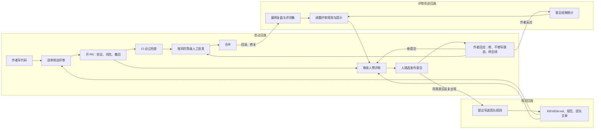

# 评审协作：把分层评审接进 Paraself

状态：方案用户已看过，暂无修改意见；界面已在设计稿“评审协作”页出图，待用户审阅；产品未实现。2026-11-18。团队分享的细节见 [团队知识整理与发布方案](team-knowledge-publication-design.md)，它是本方案的知识回路。

## 一句话

照 Claude Code 团队的分层评审组织每一次改动：机器先拦能拦的，人只看需要人判断的。Paraself 在每个人的机器上自动做四件事：

- 作者送审前做一次自评审；
- 审阅人收到 PR 时预先评审好；
- 作者收到意见后交给模型修复；
- 反复出现的意见沉淀进团队仓库，成为所有人评审时读到的规则。

代码平台上的 PR 是唯一的协作总线。Paraself 之间不直接通信，协作状态都写在 PR 上；没装 Paraself 的同学看到的，也只是普通的 PR 描述、评论和任务。

## 原文的四个阶段

依据 [How the Claude Code team does code review](https://claude.dev/blog/solving-code-review-at-anthropic/)（2026-10-15）。原文把问题从“人读过代码没有”换成“这次改动可能出什么错，哪一道检查最该拦住它”，因为稀缺的是人的时间和注意力。原文最后给的采用清单分四个阶段：

| 阶段 | 原文做法 |
| --- | --- |
| PR 之前 | 给 agent 能运行的检查；本地跑评审，或用新上下文的子代理评审；写 REVIEW.md，把反复出现的评审意见挪进去 |
| 每个 PR | 必过 CI；PR 模板写测试、风险、怎么撤回；AI 评审先在一个仓库调几周再推广；加安全评审，所有评审线程解决后才能合并；评审力度按风险选；评审轮数封顶，之后只审新 diff |
| 批准 | 风险等级按改动定，不按作者定；先严后松，用证据放宽；轻量路径只给信任的作者；认证、计费、CI 与发布流程、安装程序总要人看；机器人的批准不能替代必需的人；有新提交就撤销批准 |
| 合并之后 | 合并队列、功能开关、内部先用、分批发布、一键回滚；事故和回滚做成评测集，评审器的提示、工具或模型一变就重新打分；衡量人花的时间，以回滚率和事故率为护栏 |

## Paraself 现在有什么

| 原文做法 | Paraself 现在 | 缺口 |
| --- | --- | --- |
| PR 前用新上下文评审 | `paraself-review` 技能，给 Codex、Claude Code 用，只读；用户的习惯是写完一批改动就另开会话评审 | App 不参与，结果进不了 PR |
| 每个 PR 的 AI 评审 | PR 评审：列表分“待我评审”“我创建的”“已合并”；先广后严的发现，三态核验（成立、不成立、待核实）；深审另加规则视角；会检索个人决策 | 只能手动开始；规则只来自本机目录；仓库里只读根目录的 CLAUDE.md、AGENTS.md，而且按源提交读；不读 REVIEW.md、CODEOWNERS |
| 发布与阻塞 | 逐条或批量发布为行内评论，可发评审摘要；有批准、需要修改、合并按钮 | 不建任务；未解决的 P1 只提示、不拦；发布后不跟踪回复、解决状态和是否修了 |
| 只审新增、轮数封顶 | 有“之后有更新”提示，可只评审 diff 变过的文件；上次的问题会带入，可复核仍然存在还是已不存在 | 按文件而不是按提交；没有轮数；和 PR 上已有评论去重只靠提示词 |
| PR 模板 | PR 概览（describe）可以发布或复制 | 没有验证、风险、撤回三段 |
| 风险分级 | 本地审阅有高风险拦截：CI 配置、Git 行为文件与钩子、符号链接、子模块、新增可执行位、LFS | PR 评审没有等级，也不读构建状态 |
| 修复 | 本地审阅：人写意见，模型评估、分组、修改，推新分支开 PR | 不能以 PR 上收到的意见为输入，也不能推回原 PR |
| 评测集 | 真实 PR 回放：后来被修复的缺陷退回到引入它的提交当作 PR，人工标注和计分，用冻结的保留集；实跑时放过少量“不该报的反例” | 样本只来自本仓库、靠手工整理，只能逐个样本计分；没有成规模的干净集，也不统计有害意见；线上的漏网和误报不会回流；评审改动不经过闸门也能上线 |
| 噪声 | 回放时人工判定 | 已发布意见没有结果统计；评审历史存在渲染进程的 localStorage，上限 2 MiB，只在单机 |
| 沉淀 | 发现可以记为决策草稿；PR 评论识别每 30 分钟读一次评论，从讨论里提议决策 | 个人规则进不了团队仓库；团队分享还在设计 |

## 整体设计：三条回路，一条总线



- **改动回路**：每个 PR 走一遍。原文七层里属于团队一侧的照做，Paraself 负责作者与审阅人两端的自动化。
- **评审改进回路**：管评审器自己的质量。线上看作者对每条意见的反应；线下用缺陷集测能不能找出问题，用干净集测会不会乱提。评审的任何改动都要先过这两个集合。
- **知识回路**：把个人沉淀和反复出现的意见变成仓库里的规则，团队分享是它的写入通道。

## 改动回路：一次改动的一生

| 环节 | 对应原文 | 谁来做 | 自动化 |
| --- | --- | --- | --- |
| 1. 写之前查规则 | PR 之前 | 作者的 agent | 已有：agent 读仓库的 AGENTS.md、CLAUDE.md，用 `paraself-memory` 查个人决策 |
| 2. 送审前自评审 | 第 1 层 | 作者的 agent 与 Paraself | 新上下文、只出报告；逐条核对仓库规范和个人沉淀；发现交给 agent 或本地审阅修复 |
| 3. 开 PR | 第 4 层的 PR 模板 | 作者的 Paraself 起草，作者确认 | 描述固定三段：验证、风险、撤回；附风险等级 |
| 4. 必过检查 | 第 4 层 | 团队 CI | Paraself 只读构建状态 |
| 5. 审阅人预评审 | 第 2 层 | 审阅人的 Paraself | 被加为审阅人或有新提交时自动跑，力度按风险等级选，人打开时结果已经准备好 |
| 6. 发布意见 | 第 2、3 层 | 审阅人挑选 | 每条带类别、严重度、依据；成立的正确性和安全问题发布为阻塞项 |
| 7. 作者回应 | 每条意见都要回应 | 作者的 Paraself 汇总，作者决定 | 修：交给本地审阅，修好后作为新提交推回原 PR；不修：写理由；转后续：建待办 |
| 8. 收敛 | 轮数封顶、只审新 diff | 审阅人的 Paraself | 只审新提交；核对已发布意见是否修了；不重复；第三轮后停止自动评审 |
| 9. 批准 | 第 5 层 | 审阅人 | 显示风险等级要求的人数和是否满足；快速批准要满足条件并写明依据 |
| 10. 合并之后 | 第 6、7 层 | 团队 | 回滚、开关、发布节奏属团队流程；Paraself 只盯回滚和修复提交，触发漏网复盘 |

### 送审前自评审

用户现在的做法是：写完一批改动，另开一个会话让 Codex 用新上下文只读评审，逐条核对仓库规范和 Paraself 沉淀；与会话里已定的事冲突的，标成需要人工决定。方案把它分成两段：

- **推送前**：作者的 agent 用 `paraself-review` 技能，在新会话里只读评审。技能补一张逐条核对表：仓库规范、团队文章、个人决策与偏好各占一段，每条写是否适用、是否符合、依据在哪，不抽查。
- **开 PR 之后**：Paraself 在“我创建的”里对自己的 PR 跑一次评审，沿用现有流程。发现交给 agent 或本地审阅修复。第二版起，自己新开的 PR 自动跑。平台支持草稿 PR 时，先开草稿，自评审完再送审。
- **PR 描述**：在现有 PR 概览上加三段，由 Paraself 起草，作者确认后写回。
  - 验证：跑了哪些检查；自评审发现几条、修了几条，没修的写理由。
  - 风险：等级与依据，影响到哪些模块。
  - 撤回：怎么撤，哪些撤不掉（数据迁移、已发出的消息等）。

### 风险等级

等级按改动的文件和类型定，不由作者选。一个 PR 取它改动里最高的等级。

| 等级 | 默认范围 | 评审力度 | 批准 |
| --- | --- | --- | --- |
| 低 | 文档、文案、测试、开关后的新增 | 默认评审 | 1 人 |
| 中 | 普通业务改动 | 默认评审 | 1 人细审 |
| 高 | 认证与权限、计费、数据迁移、CI 与发布流程、安装与升级、Git 行为文件、评审规则文件本身 | 深审 | 2 人，含该区域负责人 |

- 路径表放在被评审仓库的 REVIEW.md 里。仓库没写时用默认表；默认的高风险路径复用本地审阅的拦截清单，再加仓库自己标的敏感模块。
- **路径表的格式**（2026-11-18 定，`packages/protocol/src/pr-review-risk.ts`）：写在 REVIEW.md 的“## 风险路径”（或“## Risk paths”）一节，取这一节下的第一张表，要有“等级”“路径”两列，“说明”可选。

  ```markdown
  ## 风险路径

  | 等级 | 路径 | 说明 |
  | --- | --- | --- |
  | 高 | `apps/auth/**`、`db/migrations/**` | 认证与数据迁移 |
  | 低 | `docs/**` | 文档 |
  ```

  - 等级写高、中、低（或 high、medium、low）。路径相对仓库根，`**` 可以跨目录，`*` 不跨目录，一格可以写多个，用顿号、逗号或空格分开。
  - 一个文件命中多行时取最高的等级；表里没覆盖的文件按默认判断：测试和文档为低，其余为中。
  - 评审规则文件（REVIEW.md、AGENTS.md、CLAUDE.md、CODEOWNERS），以及本地审阅会拦下的 CI 配置和 Git 行为文件，表里怎么写都是高风险。
  - 读不了的行跳过，并在风险等级旁说明。本地审阅的另外几类拦截（符号链接、子模块、新增可执行位、LFS）要看文件模式，平台的 PR 文件列表不给，PR 的风险等级暂不判断这几类。
- **规则一律从目标分支读。** REVIEW.md、AGENTS.md、CLAUDE.md 和路径表都按目标分支的版本用，否则一个 PR 可以改掉约束自己的规则。改动这些文件的 PR 本身是高风险。现在 CLAUDE.md、AGENTS.md 是按源提交读的，要一起改。
- 原文的低风险在自动检查全绿后可以零人工；这里先要 1 人，先严后松，有数据再放宽。
- AI 的批准不算人。批准之后又有新提交，Paraself 提示需要重新批准。

### 预评审与发布

- **自动预评审**（第二版）：复用现有每 30 分钟一次的轮询（现在只用于 PR 评论识别）。发现“待我评审”里有新 PR 或新提交，就按风险等级跑评审。每个连接设每日预算，超出后只列出、不跑。结果只在本机，人打开时已经准备好。
- **发布**：沿用逐条或批量发布，人决定发什么。每条评论末尾加一行可读的标记，写明依据、类别、严重度和“Paraself 预评审”。
- **阻塞项**：成立的 P1（正确性、安全）发布时设为阻塞。Bitbucket 用任务，配合“没有未完成任务”的合并检查；GitHub、GitLab 用“讨论解决后才能合并”。误报由作者写理由，审阅人确认后解除。
  - 第一版的做法（2026-11-18，IMP-195）：P1 默认设为阻塞，审阅人可以逐条取消；只有个人依据的问题不能设为阻塞。只凭代码本身、不引规则的 P1 也能设为阻塞，因为正确性和安全问题多半不需要规则出处。画板 2 上写的“只有仓库规则支撑的问题可以设为阻塞”比这里严，按这里做，用户 2026-11-18 确认。
  - 后续（用户 2026-11-18 提出，整个流程做完后再商量）：在个人规则里标记是否阻塞，按标记把个人规则支撑的问题也设为阻塞。
  - Bitbucket 发成 BLOCKER 评论（7.2 起就是任务），平台没有认成任务时照实说是普通评论。GitHub、GitLab 发普通评论，发布框里写明要仓库开启“讨论解决后才能合并”才拦得住；仓库是否开启暂不读取。
- **多人去重**：几个审阅人都装了 Paraself 时，各自在本机预评审。发布前读取 PR 上已有的评论，按位置和类别去重，只发新的；评审摘要每个 PR 只留一份。现在这一步只靠提示词，要改成确定性比对。

### 意见的依据分三级

| 依据 | 能否要求作者改 | 发布形式 |
| --- | --- | --- |
| 仓库里的规则（REVIEW.md、规范文档、AGENTS.md） | 能，严重的设为阻塞 | 写明规则出处 |
| 团队文章 | 能，作为参考依据 | 写明文章 |
| 只在个人 Paraself 里的决策或偏好 | 不能强制，只作建议，不设阻塞 | 用自己的话写清理由，不放个人笔记链接；同时进入知识回路，提议写进仓库 |
| 本机评审规则里标了 `enforcement: blocking` 的（用户 2026-11-19 确认） | 依据它的 P1 能设为阻塞，其余仍只作建议 | 评论里完整引用规则原文，末尾写“依据 审阅人的规则（标记为阻塞）”；这条规则自动进入晋升提议 |

同学和他们的 agent 看不到你的个人沉淀，拿它当硬性要求不公平，也不可持续。所以只在 Paraself 里的规则，要先晋升到仓库再要求。

例外是用户自己在本机评审规则里标明要压实的：frontmatter 写 `enforcement: blocking`。字段是字符串而不是开关，以后可以加档位（比如必须回应但不阻塞）；不认识的值按 `advisory`（只作建议，默认）处理并在读规则时提示，写错只会降级。只有 P1 能借它阻塞，评论要完整引用规则原文，让作者看到要守的是什么；正文里把引用删掉就不能再设为阻塞。拿个人规则要求别人本身就说明它该写进仓库，所以这类规则依据的意见一发出，它就进入晋升提议。决策暂不支持这个标记。

第一版的判定方法：评审提示本来就要求问题在正文里写明出自哪个文件、引用了哪条决策，所以按正文和引用来分，不另改提示（`packages/protocol/src/pr-review-basis.ts`）。正文点名了目标分支上读到的仓库规范文件，算仓库规则；只引用了个人决策或本机评审规则，算个人依据；都没有的，是只凭代码本身的问题，不标依据。团队文章一级要等团队分享做出来。

### 作者回应与修复

- “我创建的”里汇总每个 PR 收到的意见（人和 AI 的都算）、未完成的任务和构建状态。
- 每条意见要有去向：
  - **修**：交给本地审阅。它多一种输入，就是“PR 上的意见”；评估、分组、修改照现有流程。修好后不另开分支，而是作为新提交推到原 PR 分支。推送前核对远端分支头仍是已知提交，变了就停，不强推。
  - **不修**：写理由，发出标准回复：误报、有意为之或不处理。
  - **转后续**：建待办，回复里写明。
- 修完后，Paraself 更新 PR 描述里的“本轮变化”一段：改了什么，回应了哪些评论。

### 收敛

- 审阅人的 Paraself 记下每轮评审到的源提交。新一轮只看上次提交到这次提交之间的变化（现在按文件比），并复核已发布的意见是否修了，复核沿用现有能力。
- 已发布的意见、被作者写理由驳回的意见，都不再报；同一位置的同类问题只报一次。
- 同一个 PR 到第三轮后停止自动预评审，提示约人当面谈，或请作者重新考虑方案。手动评审仍然可以跑。

### 批准

- Paraself 显示风险等级、需要几个人批准、已批准几人、构建状态和未完成任务数。
- **快速批准**：只用于低风险 PR，条件是构建通过、没有未完成任务、预评审没有成立的问题、PR 描述三段齐全。批准评论附上这些依据，再加一句“这些检查拦不住什么”。原文的说法是：说不出检查会漏掉什么，就请人认真审，不要快速批准。
- 现在的批准按钮在 P1 未解决时只提示。改为：有未完成的阻塞项或未解决的 P1 时，批准要写明理由。

## 评审改进回路

### 跟踪每条已发布意见的结果

发布后，轮询顺带读取评论回复、解决状态、任务状态和后续提交，给每条意见一个结果：修了、说错了、有意为之、无所谓、未回应。前四种来自作者在 Paraself 里点选后发出的标准回复；该位置在之后的提交里被改过的，记为“可能修了”，和标准回复分开统计。

评审历史要从渲染进程的 localStorage 移到主进程的持久存储，按仓库保存，否则跨轮、跨月的统计无从谈起。

### 噪声统计

按依据、类别、严重度统计各种结果的比例。“说错了”和“无所谓”多的规则，先停用或改写。优先级照原文：先抓真问题，其次减少评审轮数。只有误报率被数据证明足够低，才考虑让成立的意见自动发布。

### 漏网复盘

已合并的 PR 被回滚，或后来的修复提交指向它时，Paraself 提示做一次漏网复盘，写四行：

- 问题是什么；
- 本该哪一层拦住；
- 为什么没拦住；
- 改在哪里：规则、提示、检查，还是团队规范。

复盘记进个人决策的结果字段。引入缺陷的那次改动成为缺陷集的候选样本，见下一节。

### 评测集：有问题的 PR 测找问题，没问题的 PR 测乱提

原文用两类历史 PR 给评审器打分：

- 造成过事故的 PR，连同它的修复，看评审能不能找出问题；
- 已知干净的 PR，看评审会不会提出照做反而有害的意见。

现有的[真实 PR 回放](pr-review-replay.md)已经做到前一半：把后来被修复的缺陷退回到引入它的提交，当作 PR 来评，再人工标注和计分。这里在它的基础上补齐两个集合，加一道闸门。

| | 缺陷集 | 干净集 |
| --- | --- | --- |
| 回答的问题 | 有问题的 PR，评审能不能找出来 | 没问题的 PR，评审会不会乱提 |
| 样本从哪来 | 合并后被回滚或修复的 PR，退回到问题还没修时的提交；评审中作者确认“修了”的问题，退回到修之前的提交 | 合并后 60 天内没被回滚、没被修复、新增的行也没人改过的 PR，按风险等级和模块抽样；作者回复“说错了”并经人确认的意见所在的 PR |
| 答案 | 熟悉代码的人确认：什么问题、在哪几行、修复提交是哪个 | 默认没有硬缺陷；“说错了”的那条意见记为已知误报 |
| 怎么判 | 意见落在标注位置附近、说的是同一个问题，算命中 | 每条意见由人判：有害（照做会引入错误或无谓改动）、噪声（无害但没价值）、有效（其实是真问题，转入缺陷集） |
| 指标 | 缺陷召回（候选、最终）、被核验误杀的数量 | 每 10 个 PR 的有害意见数、每个 PR 的意见数、已知误报是否再犯 |

- **修复对照**：缺陷集的每个样本都有对应的修复提交。在修复后的版本上再跑一次，同一个问题不该再报，用来检验“已修的不重复”。
- **闸门**：以下几类改动，前后都要在两个集合上各跑一次：评审的提示、模型和工具，本机评审规则，准备写进 REVIEW.md 的新规则。缺陷召回不降、有害意见不增，才能采用。两项都看时先看召回，再看噪声，顺序和原文“先抓真问题，其次减少评审轮数”一致。“列表接口都要分页”这类规则，会在干净集里只读小表的 PR 上暴露出来。
- **留出集**：两个集合都按固定种子分成开发集和留出集。调提示时只看开发集；要不要采用，看留出集。留出集的答案不给调提示的人看，沿用现有回放的做法。
- **样本只存引用**：只存仓库、提交号、标注位置和一句话说明，不复制源码；回放时按固定提交从平台或本地仓库读取。Git 对象要一直保留，否则样本作废。
- **规模与成本**：试点仓库先各整理 20 个左右，以后靠线上事件补充；候选样本都要人确认才入集。样本少时只报计数、不报百分比，也不拿一两个 PR 的变化宣称召回提升了。全量评测在改动前后手动跑，另外每周跑一次，受预算约束，不放进 CI。
- **线上回流**：漏网复盘、作者回复“说错了”、作者确认“修了”的意见，都作为候选样本列在“评审质量”页，人确认后入集。

### 录入：MCP 工具

历史样本主要由 agent 在单独的会话里整理：翻历史 PR、回滚和修复提交，或从任务系统的缺陷单找到对应的修复，再统一录入。录入、校验和保存都由 App 负责，agent 只经 `paraself` MCP 调用。工具按[命名约定](decisions/naming.md)命名：评测集叫 review benchmark，由缺陷集（defect）和干净集（clean）组成，一个样本叫 case。

| 工具 | 做什么 | 约束 |
| --- | --- | --- |
| `record_review_benchmark_cases` | 批量录入候选样本，指明缺陷集或干净集 | 只在用户要求整理评测集时用。录入后一律是候选，不直接入集。同一仓库、同一问题版本（加评审范围）只存一份：重复提交返回已有的编号，已经录在另一个集合里的退回 |
| `list_review_benchmark_cases` | 按仓库、集合、状态、来源编号列出样本，并给出各集合的数量 | 只读。录入前先查，避免重复。留出集样本只返回引用和状态，不返回答案 |
| `get_review_benchmark_case` | 读一个样本的引用、标注、状态和变更记录 | 只读。留出集样本不返回答案 |
| `update_review_benchmark_case` | 补充或修正标注、加备注、撤回；用户明确说核对过时确认入集 | 确认时要附上用户的原话，没有就拒绝；撤回要写理由。带 `expectedStatus`，防止覆盖别人刚改的状态 |

一个样本的字段：

| 字段 | 两个集合共有 | 缺陷集另有 | 干净集另有 |
| --- | --- | --- | --- |
| 版本 | `repositoryPath`（本地仓库，用来认仓库、核对提交）、`headSha`（评审时的提交）、`targetSha`（当时的目标分支）、可选 `scope`（只评这些文件） | `issues[].fixShas`：修复提交 | `mergedAt`：合并日期 |
| 引用 | 可选 `pr`（平台、仓库、编号和可选的链接；Bitbucket 的项目写在仓库名里，如 `PROJECT/repo`）、`title`（PR 自己的标题，回放时给评审看，不能写问题） | — | — |
| 答案 | — | `issues[]`：标题、P1–P3、位置（文件、起止行、新旧版本）、一段证据、是否属于作者接受的取舍 | `cleanEvidence`：怎么确认的干净；可选 `knownFalsePositives[]`：评审提过的意见和它为什么不成立 |
| 来源 | `provenance[]`：回滚、修复提交、任务系统的缺陷单、漏网复盘、作者反应、抽样或其他，附编号和可选链接 | — | — |

- **App 负责校验**：提交号要写完整，并且在本地仓库里存在；问题版本里不能已经包含修复提交（squash 合并后修复提交的时间先后不可靠，所以按包含关系判断）；标注的文件和行号在对应版本里存在；文字字段限长。校验不过就退回并说明原因，不静默改写。
- **开发集和留出集由 App 分**：按仓库、问题版本和评审范围，用固定种子算哈希来分，约三分之一进留出集，agent 不能指定，避免整理样本的人挑着放。
- **只存引用和标注**：不收源码、凭据和完整讨论；证据只写一段话。
- **存在 App 的本机数据里，按仓库分**：不放进 Obsidian 笔记，也不放进本仓库。放进笔记的话，笔记检索会把留出集的答案暴露给 agent；本仓库又会同步到公开仓库。
- **评测时导出**：回放命令从 App 导出已确认的样本，生成回放要的 case 文件，答案另放一个文件，和现在的回放一致。再按集合汇总计分：缺陷命中数、每 10 个 PR 的有害意见数。
- **整理方法写进 `paraself-memory` 技能**：
  - 缺陷集：从回滚、修复提交或缺陷单出发，在修复提交的父版本上用 `git blame` 找到引入问题的提交和它所在的 PR，标注修复改动的那几行。
  - 干净集：挑合并超过 60 天的 PR，确认没有被回滚、新增的行没被修复提交改过、任务系统里也没有关联它的缺陷。
  - 两类都是一个 PR 一个样本，录入前先查重。

### 团队指标

只用代码平台的数据：每个 PR 的人工批准数、人工评论数、等人的时间。护栏是回滚率和漏网数；护栏变差，说明人的时间没省下，只是挪到了线上。

## 知识回路

- **输入**：已有两个。一是发现可以“记为决策”；二是 PR 评论识别会从讨论里提议决策，同学在你 PR 上的意见也会成为你的候选沉淀。
- **晋升信号**：
  - 同一条个人规则支撑的意见在两个以上 PR 里出现；
  - 正确性或安全类的问题出现一次；
  - 作者回复“仓库里没有这条规则”；
  - 同学踩到了只记在个人 Paraself 里的决定。
- **动作**：Paraself 提议晋升，走团队分享流程（整理草稿、自检、提 PR）。目标有两类：被评审代码仓库的 REVIEW.md 与规范文档，存放要守的规则；团队知识仓库的文章与技能，存放参考。合入后，下一次评审从目标分支读到它。
- **阶梯**：个人决策 → 团队文章 → REVIEW.md 的一条 → lint、测试或 CI 检查。写成检查后，删掉对应的文字规则，让规则文件保持短。
- **知识 PR 也走改动回路**：照样自检、预评审、按风险分级；改 REVIEW.md 与 AGENTS.md 属于高风险。
- 本机规则目录（`userData/review-rules/` 等）保留，放个人规则；团队规则从仓库读。

## 协作总线：PR 上写什么

| 内容 | 写在哪 | 谁写 | 谁读 |
| --- | --- | --- | --- |
| 验证、风险、撤回三段，风险等级与依据 | PR 描述 | 作者的 Paraself 起草，作者确认 | 审阅人和审阅人的 Paraself |
| 预评审意见 | 行内评论，末尾一行标记 | 审阅人挑选后发布 | 作者的 Paraself |
| 阻塞项 | Bitbucket 任务，或未解决的讨论 | 审阅人 | 合并检查 |
| 回应 | 评论回复：已修、误报、有意为之、不处理，附说明 | 作者确认后发出 | 审阅人的 Paraself，用于结果统计 |
| 本轮变化 | PR 描述的一段 | 作者的 Paraself | 审阅人和其 Paraself |
| 已评审到哪个提交 | 评审摘要评论里的提交号 | 审阅人的 Paraself | 其他审阅人的 Paraself，用于去重 |

- 标记用人能读懂的短文字，不依赖隐藏字段。
- 发布内容不带个人笔记链接、本机路径和个人决策编号。

## 各模块的改动

| 模块 | 改动 | 主要代码 |
| --- | --- | --- |
| PR 评审 | 从目标分支读 REVIEW.md、路径表和指南；风险等级；依据分级；阻塞项；读构建状态；批准面板与快速批准；按提交增量、轮数；确定性去重 | `apps/desktop/src/main/pr-review-service.ts`、`pr-platform-client.ts`、`packages/protocol/src/pr-review.ts` |
| 评审历史 | 从渲染进程 localStorage 移到主进程持久存储；记录发布后的结果 | `apps/desktop/src/renderer/components/pages/pr-review/review-history.ts` |
| 轮询 | 在 PR 评论识别的轮询上加自动预评审和发布后跟踪，按连接设预算 | `apps/desktop/src/main/pr-comment-candidates.ts`、`apps/desktop/src/main/index.ts` |
| 本地审阅 | 新输入“PR 上的意见”；推回原 PR 分支；标准回复 | `apps/desktop/src/main/local-review-service.ts`、`local-review-git.ts` |
| PR 概览 | 验证、风险、撤回三段 | PR 概览（describe）命令 |
| 技能 | `paraself-review` 加逐条核对表和依据分级 | `skills/paraself-review/SKILL.md` |
| 团队分享 | 入口加评审页的晋升提议；目标加代码仓库的 REVIEW.md | 见团队分享方案 |
| 回放与评测 | 缺陷集与干净集的样本准备、修复对照、按集合计分与闸门；之后在 App 里列候选样本、对比改动前后 | `docs/pr-review-replay.md`、`scripts/lab/`、`scripts/` 下的回放命令 |
| 评测集录入 | 评测集的四个 MCP 工具；App 侧的样本存储、校验、分开发集和留出集、导出给回放；`paraself-memory` 技能补整理方法 | `apps/bridge/src/`（参照 `mcp-todo.ts`）、`apps/desktop/src/main/`、`packages/protocol/src/`、`skills/paraself-memory/references/` |

## MCP 工具

按[命名约定](decisions/naming.md)命名。用户在界面上能做的事，agent 经 MCP 也能做，受同样的确认和权限约束；写工具只在用户要求时使用。现有的 PR 评审和本地审阅还没有 MCP 工具，这次一并补上。

| 功能 | 工具 | 版本 |
| --- | --- | --- |
| PR 列表 | `list_prs`：按连接和视图（待我评审、我创建的、已合并）列出，附风险等级、构建状态、预评审状态、第几轮 | 第一版 |
| PR 描述 | `get_pr_description_draft`：验证、风险、撤回三段的草稿；`update_pr`：按用户要求写回描述，不包括批准和合并 | 第一版 |
| PR 评审 | `run_pr_review`：开始评审，可选默认或深审；`list_pr_reviews`：历史评审；`get_pr_review`：问题、待核实、未定位、依据、第几轮 | 第一版 |
| 评审意见 | `update_pr_review_finding`：不采纳并写理由、复评结论、是否设为阻塞；`record_pr_comments`：把选定的意见发到 PR，可以设为阻塞 | 第一版 |
| 评测集 | `record_review_benchmark_cases`、`list_review_benchmark_cases`、`get_review_benchmark_case`、`update_review_benchmark_case` | 第一版 |
| 自动预评审设置 | `get_pr_review_settings`、`update_pr_review_settings`：开关、每日预算、使用的模型 | 第二版 |
| 作者回应 | `list_pr_comments`：我的 PR 收到的意见和去向；`update_pr_comment`：记下去向（修、不修、转后续），按用户要求发出标准回复 | 第二版 |
| 本地审阅 | `record_local_review_job`：提交一批意见，可以来自 PR；`list_local_review_jobs`、`get_local_review_job`；`update_local_review_job`：取消、重试 | 第二版 |
| 评测运行 | `run_review_benchmark`、`list_review_benchmark_runs`、`get_review_benchmark_run`：两个集合的分数，改动前后对比 | 第三版 |
| 评审质量 | `get_review_quality`：人工时间、护栏、意见结果统计；`record_review_escape`、`list_review_escapes`、`update_review_escape`：漏网复盘；`list_rule_promotion_candidates`：晋升提议 | 第三版 |

不提供的：

- **批准、需要修改、合并**：AI 的批准不算人，这三个动作只能由人在界面或平台上做。
- **高风险推送的授权**：本地审阅拦下的 CI、Git 行为文件等，同样只能由人确认。
- **删除**：用撤回代替，保留历史。

`record_pr_comments`、`update_pr_comment`、`update_pr` 会写到团队的代码平台上，工具描述里写明：只在用户明确要求发哪几条、写什么时才调用，不自动发。

## 分阶段

团队一侧是前提，不在 Paraself 里做：

- PR 构建与合并检查：构建通过、最少批准数、没有未完成任务。
- PR 模板三段：验证、风险、撤回。
- REVIEW.md 和风险路径表，配合 CODEOWNERS。
- 先在一个仓库试点几周，再推广。

Paraself 分三版，每版都按仓库的实跑规则在隔离环境里验收：

| 版本 | 内容 | 验收要点 |
| --- | --- | --- |
| 第一版：规则进仓库，评审分轻重 | 从目标分支读 REVIEW.md 和路径表；风险等级、构建状态、批准面板；意见依据分级与阻塞项；PR 描述三段；评审历史移到主进程；按提交增量、三轮封顶；评测集的 MCP 工具、样本存储与导出，按集合计分；试点仓库的缺陷集、干净集各 20 个左右，由 agent 整理录入、人确认 | 改了 REVIEW.md 的 PR 用目标分支的规则评审，并判为高风险；只有个人依据的意见不能设为阻塞；新提交后只看新增变化；重启后历史不丢；本版每项评审改动都过两个集合的闸门；录入时提交号不存在、问题版本里已包含修复提交、行号越界都会被退回；读取接口拿不到留出集的答案 |
| 第二版：两端自动配合 | 被加为审阅人时自动预评审，多人去重；“我创建的”汇总意见并给出三个去向；本地审阅按 PR 意见修复并推回原 PR；发布后跟踪结果 | 自动评审不超预算；同一 PR 不重复发同一问题、只有一份摘要；远端分支头变了就停止推送，不覆盖他人提交 |
| 第三版：闭环 | 噪声统计与停用建议；漏网复盘；评测集进 App（候选样本队列、改动前后对比）；评审信号触发团队分享；可选：CI 里跑同一份规则 | 统计与人工抽查一致；候选样本经人确认才入集；改动在两个集合的留出集上召回不降、有害意见不增 |

进度（2026-11-18）：第一版已经实现的有三批。
- IMP-193：评测集的四个 MCP 工具、样本存储和导出，以及按集合汇总计分。
- IMP-194：规则改从目标分支读，加读 REVIEW.md，并按它的风险路径给出风险等级；意见依据分级，发布的评论末尾加标记；评审历史移到主进程；PR 评审的三个只读 MCP 工具（`list_prs`、`list_pr_reviews`、`get_pr_review`）。

- IMP-195：构建状态、批准面板和快速批准、阻塞项；评审的两个写工具 `update_pr_review_finding`、`record_pr_comments`，`list_prs` 也带上构建、批准和阻塞项。
- IMP-196：发布前确定性去重，摘要每个 PR 只留一份；旧提交上的批准、CODEOWNERS 负责人、仓库是否开启拦阻塞项的合并检查；PR 描述三段的起草和写回，`get_pr_description_draft`、`update_pr`。

- IMP-197：按提交增量评审，第三轮之后提示当面谈；`run_pr_review`。

第一版的功能都已实现，试点仓库的评测样本还没开始整理。

第二版已经实现的：
- IMP-198：作者回应。在“我创建的”里打开自己的 PR，列出别人留下的意见和每条的去向；不修发标准回复（误报、有意为之、不处理），转后续先在「PR 后续」清单里建待办再回复；批准条件加“回应”和“合并要等”；`list_pr_comments`、`update_pr_comment`。

- IMP-199：修。选中的行内意见交给本地审阅，修复合成一个提交，作者确认后推回原 PR 的分支，推送前核对分支头、变了就停；推送后回复已修，把本轮变化写进 PR 描述；本地审阅的四个 MCP 工具。

- IMP-200：发布后跟踪结果。发布时记下评论 id；30 分钟轮询和打开记录时读回每条已发布意见的线程，按作者的标准回复记修了、说错了、有意为之、无所谓、转后续，没有回复但原位置之后被改过的记“可能修了”，其余未回应；评审页卡片和 `get_pr_review` 都显示。

- IMP-201：自动预评审。每个链接单独打开，选模型和每天最多几次（默认关闭，打开时默认 5 次）；30 分钟轮询时看“待我评审”的第一页，新 PR 或有新提交的就评审，高风险的用深度评审，之后只看新提交；一次只跑一个评审；同一个 PR 有了三轮带结果的评审后不再自动评审，在同一个提交上自动评审失败过的不再自动重试；当天的次数用完就只列出。记录标“自动”，评审页列表写今天用了几次；`get_pr_review_settings`、`update_pr_review_settings`。

第二版的功能都已实现。

第三版已经实现的：
- IMP-202：评审质量页。评审页侧栏加“评审质量”，按连接看近 30 天，和之前 30 天对比：从平台读每个已合并 PR（你评审或创建的）的人工批准数、人工评论数（不算 Paraself 的和机器人的）、从打开到第一个人批准的中位时间、回滚数，每个 PR 只读一次；已发布意见按依据（仓库规则、个人决策与本机规则、代码本身）分的结果表，“可能修了”单列；作者答复里说错了、无所谓占多数且至少两次的规则列出来，Paraself 自己的本机规则可以停用；`get_review_quality`、`update_review_rule`。
- IMP-203：漏网复盘。读评审质量时，在已合并的 PR 里找“漏网”：后来的 PR 是它的回滚（标题 `Revert "原标题"`），或在标题、描述里点名它（#12、!12、pull-requests/12）并说是修复或回滚；也可以由用户经 `record_review_escape` 指出。每条写四行（问题、本该哪一层拦住、为什么没拦住、改在哪里），或写明理由标为不是漏网；Paraself 评审过的，给出问题所在的文件和行，就成为评测集缺陷集的候选样本（问题版本取那次评审的提交，修复取修复 PR 的提交）。指标卡改为“回滚 · 漏网”；`list_review_escapes`、`update_review_escape`。复盘先存在评审质量里，不写进个人决策的结果字段。
- IMP-204：评测集进 App。评审质量侧栏加“评测集”：两个集合的数量和最近一次评测的结果；运行评测时把已确认的样本按固定提交从本地仓库重放、用 App 现在的评审（同一套模型、提示和本机规则）评一遍，缺陷集按意见是否落在标注位置附近计命中和核验误杀，可选修复对照，干净集的意见由用户判有害、噪声或有效；和上一次评测对比给出结论（先看召回，再看有害意见，有没判的先判），可以记为采用；留出集只给总数。候选样本队列：已录的候选在这里确认入集，作者确认“修了”、回复“说错了”的意见和合并超过 60 天、没有回滚或修复指向它的 PR 列为建议，收为候选或不收；`run_review_benchmark`、`list_review_benchmark_runs`、`get_review_benchmark_run`。
- IMP-205：晋升提议。评审质量页列出该写进仓库 REVIEW.md 的个人规则：同一条决策或本机规则支撑的意见出现在两个以上 PR、依据它的 P1 被修了、作者回复仓库里没有这条规则，或漏网复盘说要改规则或团队规范；被说错和无所谓的多于被修的规则算噪声，不提议。每条附依据、例子和一行草稿，用户改好草稿后“提议写进 REVIEW.md”，交给本地审阅作为这个文件上的意见：在隔离副本里改文件、自检，REVIEW.md、AGENTS.md、CLAUDE.md 在本地审阅里也算高风险文件，要用户确认后才推送分支并开 PR；`list_rule_promotion_candidates`。团队分享流程还没实现，提议先走本地审阅；目标只有被评审仓库的 REVIEW.md。

第三版的功能都已实现；“可选：CI 里跑同一份规则”没有做，在预期内：它指把 Paraself 的预评审（读目标分支的 REVIEW.md 和指南）也放进团队 CI，每个 PR 自动跑，不依赖审阅人装没装 Paraself。这要脱离桌面 App 的命令行评审器、CI 里的模型凭据、每个 PR 的模型额度，代码还会从 CI 机器发给模型服务商，是团队基础设施的决定，也和“不做：替代 CI”相冲突。它和规则阶梯最后一级（把一条规则改写成 lint、测试这类确定性检查）不是一回事，后者逐条由人或 agent 写，不需要新功能。以后要做，IMP-204 的按固定提交读本地仓库的评审可以包成命令行；CI 里只用仓库规则，个人规则本来就不在里面。

第二版要等第一版发布的意见经人工判定、误报低再做；第三版要等积累了足够的已发布意见和合并记录。各版的 MCP 工具随功能一起交付，见“MCP 工具”一节。

用户 2026-11-18 要求先把整个流程（第一版剩下的、第二版、第三版）都做完再商量后续，上面两条等待改为“功能先做好，会花模型额度或写平台的自动行为默认关闭，由用户打开”。

不做：

- Paraself 之间直接通信，或自建服务端；
- 自动批准、自动合并；
- 替代 CI；
- 未经人确认就自动发布意见。

## 界面设计（2026-11-18）

设计稿：[Paraself 设计](https://claude.ai/artifact/CsaWzJMXPFhNHPNEGJuw23)，“评审协作”页，Version 54（`1794983570-69d0`）。画之前用 `npm run preview:capture` 截了现有评审页和本地审阅页（预览数据），颜色、字号、控件高度取自 renderer 的 `styles.css`，主题色按紫色预设。

| 画板 | 内容 | 下方变体 |
| --- | --- | --- |
| 1 待我评审 | PR 列表加上风险等级、构建状态、预评审状态和第几轮；详情页上方是批准条件；预评审结果按依据标明“仓库规则”或“个人决策 · 只作建议” | 快速批准；第三轮后停止自动评审；预算用完 |
| 2 发布意见 | 逐条确认；阻塞项只能来自仓库规则；同位置同类意见跳过；每个 PR 只留一份评审摘要 | GitHub、GitLab 上的阻塞；发布失败一半 |
| 3 我创建的 | 收到的意见逐条选“修、不修、转后续”；本地审阅修好后作为新提交推回原 PR；本轮变化写进描述 | 推送前远端分支头变了；开 PR 时的三段描述 |
| 4 评审质量 | 人工时间与护栏；已发布意见的结果；漏网复盘；评测集入口；晋升提议，链接到团队分享页 | 左侧选“评测集”时：两个集合的规模和分数、改动前后对比、待确认的候选样本 |

列表上方新增“评审质量”标签，与“PR”“历史评审”并列。待我评审、我创建的、已合并三个视图沿用现有界面。

画板中的数据全部是合成示例。四张画板在 ego-browser 中按 1160 宽渲染过，没有溢出或被裁掉的内容；回读的 5 个文件与本地一致，其他页面、画板和便签都没有改动。Artifact 播放模式下的点击和 960×640 小窗口还没验证。

## 未核实

- **任务阻塞合并**：Bitbucket Data Center 的合并检查里有“没有未完成任务”（[Checks for merging pull requests](https://confluence.atlassian.com/display/BitbucketServer/Checks+for+merging+pull+requests)）。
- **CODEOWNERS**：要 8.14 以上。代码负责人会被自动加为审阅人，但不强制批准，要配合最少批准数（[Code owners](https://confluence.atlassian.com/spaces/BITBUCKETSERVER096/pages/1627096957/Code+owners)）。
- **新提交后撤销批准**：只在 Bitbucket Cloud 的文档里查到，Data Center 是否支持未核实；草稿 PR 是否支持也未核实。
- **团队实例**：版本、已开启的合并检查、构建状态接口都未核实。
- **成本**：多人各自预评审的模型开销未测。
- **标准回应**：能否被可靠解析，要在试点里看。
