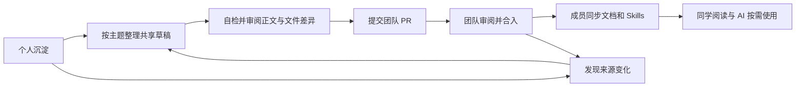

# 团队知识整理与发布方案

状态：流程与界面草案待用户审阅；2026-11-17 初稿；2026-11-18 借鉴 AI 代码评审流程调整，同日并入[评审协作方案](review-collaboration-design.md)，成为其中的知识回路。本文只设计流程，不代表已确定产品行为或已实现。

## 目标与分工

把 Paraself 中持续积累的总结、决策案例、复盘、经验、原则和技能，整理为同学与 AI 都能使用、可以持续更新的团队资料。

在评审协作里，本方案是知识回路的写入通道。评审里反复出现的意见、同学踩到的只在个人 Paraself 里的决定，经这里写进团队仓库；合入后，所有人的评审都从目标分支读到它。目标除了团队知识仓库的文章和技能，还包括被评审代码仓库的 REVIEW.md 与规范文档。

参考 fx-workspace 的 `docs/`、`skills/`、`AGENTS.md` 路由、fork PR 和成员同步方式。Paraself 负责整理与提案，团队仓库保存共享版本，现有工作区工具负责分发。首版面向一个明确配置的团队仓库和 Bitbucket PR 流程。

个人原始记录继续由个人维护；共享文章由团队共同维护。两者通过发布记录关联，不承诺逐字一致，也不自动双向改写。个人已采纳的原则仍标为个人经验；只有经过明确的团队规范提案与认可，才进入团队约定。



“提交评审”“已合入团队仓库”“成员已同步”是三个不同事实。Paraself 只在回读确认合入后显示已发布；首版不收集成员设备状态，不声称所有人已收到。

## 借鉴 AI 代码评审流程（2026-11-18）

通用规则以[评审协作方案](review-collaboration-design.md)为准，本节只说它们在知识发布里怎么用。

依据 Claude Code 团队 2026-10-15 发表的 [How the Claude Code team does code review](https://claude.dev/blog/solving-code-review-at-anthropic/)（中文解读在 knowledge-hub 站点的 `engineering/ai-code-review/`）。原文的出发点：AI 写代码快过人读代码，稀缺的是人的时间和注意力。办法是分层，自动检查拦住能拦的，人只看需要人判断的，再用回滚率当护栏。团队分享是同一个问题：一批文章整理得很快，同学评审和阅读的注意力有限。下表列出借用的做法；用到知识分享上是本方案的判断，不是原文结论。

| 原文做法 | 本方案的调整 | 首版 |
| --- | --- | --- |
| 第 1 层自验证：作者的 AI 先跑检查、拿出证据，再请人看 | 送审前自检：每段要对得上来源，结果写进 PR 描述，审阅人不必重查 | 做 |
| 第 3 层可阻塞的评审：有未关闭的发现就不能合并，误报写理由关闭 | 自检分阻塞项和待核对项；阻塞项不处理不能提交，误报写理由 | 做 |
| 第 4 层 PR 模板：问怎么测、怎么撤回，AI 填写、发起人确认 | PR 描述固定“证据、影响、撤回”三段，自动填写、用户确认 | 做 |
| 第 5 层按风险定人工审批：等级不由作者定，AI 的批准不算人 | 按文件定风险等级，高风险单独成 PR；批准规则沿用目标仓库设置 | 做 |
| 评审收敛：每条发现都要回应，三轮后请作者重新考虑，之后只审新 diff | 评论逐条回应；追加只推新提交并写明本轮回应；三轮仍有争议的文章移出本批 | 做 |
| 护栏：回滚和事故率上升，说明没省下时间，只是挪了地方 | 发布记录显示关闭未合入和合入后撤下的数量 | 做，只计数 |
| 闭环：评审漏了，就把修复写进 CLAUDE.md、skill 或新检查 | 内容晋升阶梯：文章 → 技能 → 团队规范 → 自动检查；出错先撤后修，复盘该在哪一环拦住 | 只发前两级 |
| 评审器调优：按作者反应量噪声，在事故集上每天评测 | 让模型按仓库评审要点自评，先在本地把误报磨低再接入 | 后续 |

原文的低风险改动在自动检查全绿后可以不经人工；本方案低风险仍要 1 人批准。团队仓库刚开始接收这类内容，先严后松。

## 第一次连接团队仓库

配置目标仓库、目标分支、个人 fork 或允许推送的贡献仓库、文档目录和审阅人；显示可核对的账户与仓库身份，不能根据 `origin` 名称猜推送目的地。认证复用现有 Git 与代码平台连接能力，凭据留在系统凭据存储。

检查仓库现有的文档目录、指南和 Skills，确定本次内容该放哪里。只接入已有仓库；创建仓库、改变访问权限及安装成员工具属于另外的操作。实际接入的团队和资料可见范围在配置时明确，不将示例团队当成默认目标。

## 首次整理与发布

1. **选择范围。** 支持按项目、主题、时间段或明确选中的记录整理，也能盘点全部可分享沉淀。列出读取成功、未选中、已分享、待核对、读取失败的数量与原因；不能把部分读取成功说成全量完成。也可以从评审页的晋升提议进入：同一条个人规则在多个 PR 的意见里出现时，Paraself 带着相关来源和那几条意见打开整理。
2. **归并主题。** 优先复用已有总结和经验，多条相关来源形成一篇文章。对照团队已有目录与文章，建议新增、补充现有文章或跳过重复。相似只用于提示，不能自动合并不同适用范围的结论。
3. **生成可编辑草稿。** 按“结论—适用场景—理由与案例—结果—例外—出处”组织。生成可选，沿用现有模型配置与网络策略；直接整理已有 Markdown 也能完成。模型不能把推测补成事实，来源或证据不足必须保留说明。
4. **审阅实际发布内容。** 展示最终正文、来源对照、将新增/修改/删除的文件以及完整差异；批量发布可以按主题逐份检查。用户修改的正文成为后续编辑基础，重新生成不能覆盖手工修改。来源变动会使对应草稿变为待核对。同一步完成送审前自检（见下文）。批次宜小：一个 PR 只放少数几篇，便于审完，也便于单独撤回。
5. **提交团队评审。** 自检没有未处理的阻塞项后，用户选择“提交团队评审”。Paraself 按风险等级拆分（高风险文件单独成 PR），在隔离 Git 副本上生成提交，推送贡献分支，创建或续用该批次 PR。显示最终目标仓库、分支、风险等级、审阅人、文件与三段式 PR 描述；平台拒绝或认证失败时保留草稿和已有进度。
6. **回读合入结果。** 团队按原有流程审阅与合并。Paraself 在用户打开发布记录或刷新时读取 PR 和目标分支；确认本批次文件的实际合入版本后，记录 PR、提交和内容基线。被拒绝、关闭未合入或状态读取失败分别显示，不自动重提。

选中来源不等于原文全部上传。默认整理总结、正式决策及复盘、已保存经验、已采纳原则和已有技能/流程；想法与候选内容需要显式选入，保留“待验证”身份，仅作为文档。个人偏好、原始待办、完整对话、采集队列和“仅本机保留”的记录不默认进入分享范围。

发布前按字段白名单生成共享内容，检查凭据、本机路径、个人信息和内部链接的可见范围。检测只辅助审阅，不能保证完成脱敏。原始来源的精确映射保存在本机；团队文章只带已选择公开的摘要、证据和团队可访问的链接。私有出处没有共享时，明确“来源未随文共享”，不能留下打不开的个人笔记链接冒充团队证据。

## 送审前自检

预览时对最终要提交的正文和文件跑一遍检查。规则优先沿用目标仓库已有的评审要点（如 REVIEW.md 里关于文档的条目），没有时用 Paraself 默认清单，不另立标准。

| 类别 | 检查项 | 处理 |
| --- | --- | --- |
| 阻塞项 | 段落对不上任何来源，也没标“作者判断”；本机绝对路径；凭据格式文本；指向个人笔记或团队打不开的链接；本批管理范围以外的文件、符号链接、同名占用；预览后来源或目标分支有变化 | 不处理不能提交。改掉，或写明误报理由；理由写进 PR 描述 |
| 待核对 | 来自 Agent 报告、未独立核验的段落；待验证想法；未随文共享的来源；个人经验里出现“必须”“一律”这类规范口吻；与团队已有文章结论相近或冲突 | 不拦提交，逐项写进 PR 描述，交给审阅人判断 |

首版只做确定性检查：段落与来源的对应来自草稿生成时记录的映射，路径、凭据和链接按规则匹配。让模型按仓库评审要点逐条自评放到后续，先在本地把误报磨低再接入。检查只辅助审阅，不能保证没有敏感信息；用户仍要核对最终内容。

## 风险分级与 PR 描述

风险等级按文件路径和改动类型定，不由作者选；目标仓库有自己的路径负责人或默认审阅人规则时，以仓库为准。

| 等级 | 改动 | 审批 |
| --- | --- | --- |
| 低 | `docs/` 下自己文章的新增、补充，目录索引 | 1 人批准 |
| 中 | `skills/` 下的 SKILL；修改他人写的文章；撤下 | 该领域负责人批准 |
| 高 | `AGENTS.md` 等常驻指南的路由；提议把经验升为团队规范，包括写进代码仓库的 REVIEW.md | 单独成 PR，仓库维护者审批 |

高风险改动会进入每位同学 AI 的默认上下文，影响面最大。它和文章分开送审：既不被普通文章的评审拖住，也不借文章的批准合入。AI 评审通过不算人工批准。批准之后又追加提交时，发布记录提示“批准之后有新提交”；批准是否因此失效，按仓库设置。

PR 描述自动生成，用户确认后提交，固定三段：

- **证据**：每篇的类型和证据状态（已验证案例、个人经验、待验证想法、未独立核验的 Agent 报告），以及自检的待核对项和误报说明。
- **影响**：改了哪些文件；是否涉及 SKILL、AGENTS 这类会改变 AI 行为的内容；风险等级。
- **撤回**：怎么撤（撤下 PR，标为被取代或移出目录），以及撤不掉的部分（Git 历史和成员副本）。

## 团队仓库里的形态

优先沿用目标仓库的现有结构。下面是尚无知识目录时的建议布局，不是强制协议：

```text
docs/knowledge/
  README.md                         # 按主题列出入口与内容状态
  <topic>/<article>.md               # 总结、案例、经验和原则说明
skills/<team-skill>/
  SKILL.md                          # 已成熟、可重复执行的方法
AGENTS.md                           # 仅增加必要的按需阅读入口
```

文章保留稳定的共享编号、作者、类型、适用项目/版本、证据状态、更新时间与取代关系。编号独立于标题和文件名，重命名不等于新文章。精确个人来源编号、生成过程、私有路径、账户配置和发布回执不进团队仓库。

正文先给可读的结论，再给例外和出处。参考模板：

```text
标题：数据库迁移前为什么需要兼容旧版本调用方
类型：经验案例；状态：已验证案例；适用范围：……
结论 / 使用条件 / 当时的问题与取舍 / 实际结果 / 例外与反证 / 来源
```

知识文章即使合入也只是其标注类型的材料，不能仅凭“已发布”变成团队强制规则。Skills 则需审阅触发条件、步骤、验证方式、例外及执行权限；首版发布已有技能/流程正文，不自动附带未知脚本、安装命令或附件。

团队仓库里的内容按影响面分四级。越往上，读到的人和 AI 越多，审批越严：

1. **文章**（`docs/`）：参考材料，AI 按需读取。
2. **技能**（`skills/`）：成熟、可重复执行的方法，AI 会照着步骤做。
3. **团队规范**（`AGENTS.md` 路由、REVIEW.md 等）：所有人和 AI 都要守。
4. **自动检查**（lint、测试、CI）：能用代码判断对错的规则；写成检查后，删掉对应的文字规则。

首版只发前两级。升为规范是单独的高风险 PR，要团队认可；Paraself 最多提示“可以提议升级”。值得提议的信号：同类问题第二次出现；涉及正确性或安全的问题出现一次；同学踩了只记在个人沉淀里的决定。收不收沿用目标仓库已有的口径；仓库没有口径时，默认收可复用的经验、案例、方法和反复出现的误判，不收一次性业务决定、单个需求的临时约定、个人偏好和与团队无关的经验。

更新目录索引时保留团队手工内容。已有 `AGENTS.md` 只提出必要的路由补充；使用 fx 生成的区域通过其已有渲染流程更新，不能直接覆盖。知识正文保留在 `docs/`，不全部塞入常驻指南。常驻指南每次会话都加载，越长越贵、噪声越多：路由每条一行，写触发条件和入口路径；文章撤下或被取代时，在同一个 PR 里删掉对应路由。

## 后续更新与分歧处理

每篇共享内容在本机保存来源版本、上次确认的团队正文、已审阅草稿以及 PR 状态。来源到文章允许多对多映射；来源变化先标记相关文章待检查，并不直接发 PR。对未改变的文章不重新生成、不提交时间戳变化。

更新始终从上次确认的团队正文和已有手工草稿继续，结合来源差异提出修改，不用个人原文重新覆盖整篇。对比三份内容：上次确认的团队版本、这次拟发布的版本、当前团队仓库版本。

| 发生的变化 | 处理方式 |
| --- | --- |
| 来源与团队正文都未变 | 显示最新，无提交 |
| 只有个人来源变了 | 展示来源差异，形成文章修改草稿；有效正文未变则不提交 |
| 只有团队正文变了 | 展示团队修改，用户确认后接续此版本；保留个人原始记录 |
| 两边都变了 | 展示分歧，保留双方内容，由用户编辑合并草稿；首版不自动解决正文分歧 |
| 来源读取失败或暂不可用 | 显示待重试，不能当成已删除，更不能据此撤回团队内容 |
| 来源被删除、撤回或判定过时 | 提示检查已发布文章，选择修订、标记过时、取代或提出撤下 PR |
| 团队文件改名或删除 | 用共享编号辅助定位；无法确认则显示待核对，不自动重建或强占原路径 |
| 仍有相关 PR 在评审 | 在同一批次分支上追加确认后的修改；重新核对远端提交，不能覆盖同学提交或强推 |

一个来源更新可能影响多篇文章和 Skill，按本机映射统一列出受影响项。文章存在多个作者时，不能仅因个人来源被删除就撤掉团队保留的内容。

PR 评审期间新增的个人变化标为“还有后续更新”，不混入已审阅版本。用户决定追加时重新展示差异；PR 已合入则下一次更新走新 PR。合入采用的是目标分支的实际文件内容，包括团队在评审中改过的部分；记录送审来源版本，不能把尚未送审的个人变化误记成已发布。

评审中的 PR 按以下规则收敛：

- 每条评论都要有回应：改正文、写理由不改，或说明合入后再补。
- 追加修改只推新提交，并在 PR 描述里写明这一轮改了什么、回应了哪些评论，审阅人只需看新增部分。
- 超过三轮仍有争议的文章，从本批移出、回到草稿，其余文章先合入。
- 对整篇方向有异议时回到讨论，不在 PR 里反复改。

## 撤下、恢复与失败

撤下也走 PR：文档可标记被取代并链接新结论；不应再被调用的 Skill 从活跃发现入口与分发目录移除。成员侧是否清理旧 Skill 链接需隔离验证，不能仅移除索引就声称已停用。恢复以当前团队版本为基础提出新变更，不回退整个共享仓库。

Git 历史与成员本地副本会保留既往内容。撤下不承诺远程擦除；若误发敏感内容，需要另行处理凭据撤销和历史清理，不通过普通删除 PR 假装完成。

已发布内容被发现有误时，先发一个小 PR 把它标为“待更正”或撤下，再修订，避免修订期间错误内容继续被同学读到、被 AI 使用。随后在 Paraself 记一条复盘：问题是什么，本该在哪一环拦住（来源、自检、评审），为什么没拦住，改在哪里（补自检规则、补仓库评审要点或修正来源记录）。

护栏：发布记录按最近几次送审统计已合入、评审中、关闭未合入和合入后撤下的篇数，数据只来自代码平台和本机记录。后两项变多，说明送得太快，没省下时间，只是把成本转给了评审和读者；这时应收紧默认选择范围、缩小批次。

保存每一步的意图和实际结果：草稿、提交、分支推送、PR、合入。重复点击、崩溃和网络超时后先核对远端再续作；已推送但 PR 创建失败时只补建 PR，不重复提交。结果未知时显示“待核对”，不能盲目重试外部写入。

只写本批次明确管理的文件；越界路径、符号链接、同名占用、工作副本被修改、预览后目标版本变化都需重新核对。目标变化使相应预览失效，保留用户编辑并重新准备，不自动放宽覆盖条件。

## 阅读与 AI 使用

同学可直接在代码平台阅读主题目录、文章和版本历史。已使用 fx 的工作区沿用文档与 Skills 同步流程；`AGENTS.md` 提供触发条件与入口，AI 按需读取正文、适用范围和出处。普通工作区可通过 Git 获取相同资料。

首版交付的是可阅读、可分发、可供 AI 按需查阅的文件。跨团队知识源的统一语义检索、远端 MCP 服务、成员订阅面板和同步遥测不在本轮实现范围；它们不影响先打通整理、送审和更新。

## MCP 工具

按[命名约定](decisions/naming.md)命名，首版随功能一起交付。用户在界面上能做的事，agent 经 MCP 也能做，受同样的确认和权限约束。

| 功能 | 工具 |
| --- | --- |
| 团队仓库连接 | `get_team_repository`：读当前连接的仓库、目标分支、贡献仓库、审阅人；`update_team_repository`：改这些设置，凭据不经过 MCP |
| 整理草稿 | `record_team_share_drafts`：按选定的来源整理一批草稿；`list_team_share_drafts`；`get_team_share_draft`：正文、来源对照、送审前自检结果；`update_team_share_draft`：改正文、处理待核对、放弃 |
| 送审与发布 | `record_team_share_publication`：把选定的草稿提交团队评审，推分支、建 PR；`list_team_share_publications`；`get_team_share_publication`：PR 状态、评审动态、是否已合入；`update_team_share_publication`：追加修改、把有争议的文章移出本批、提议撤下 |

不提供的：

- **合并**：由团队在代码平台上做。
- **凭据**：连接时在 App 里输入，存在系统钥匙串。
- **删除**：撤下也走 PR。

`record_team_share_publication`、`update_team_share_publication` 会推分支、建或改 PR，只在用户明确要求时调用。

## 现有能力与实现边界

| 可复用基础 | 拟复用方式与限制 |
| --- | --- |
| `organization-sources.ts`、`organization-core.ts` | 沿用来源身份、变化指纹和证据角色；补充共享范围选择，不把所有个人输入默认纳入 |
| `OrganizationService` 与已有模型配置 | 复用整理和模型调用边界；共享草稿单独保存，不让发布动作自动采纳个人知识 |
| `comparePracticeAssetSources` 与资产版本记录 | 复用来源变化提示及手工修改保护的模式；多类型文章需要自己的来源映射 |
| `PracticePublicationService` 与 `atomicWrite` | 沿用内容指纹、写入回执和中断恢复思路；现有客户端覆盖逻辑不能直接当作团队合并规则 |
| `publishedPracticeAsset` | 复用技能格式规则；现实现保留自定义正文与 frontmatter，团队发布前必须经过字段筛选和内容审阅 |
| `HostedPrClient.findPullRequest/createPullRequest` | 复用平台连接、PR 查重、创建及读取，首版只交付明确验证过的 Bitbucket 路径 |
| 本地审阅的 Git 隔离与推送能力 | 实现前核对其与审阅任务的耦合，复用适用部分；不把整个审阅流程搬进发布功能 |
| fx 的文档、Skill 路由与同步 | 复用团队分发，不在 Paraself 再做一套客户端安装与认证体系 |

后续代码会涉及协议与领域类型、主进程发布流程和本机记录、Markdown 输出、Git/PR 接入、IPC/preload/renderer 契约、页面与预览样本，以及对应验证和专题文档。不会仅在现有“发布到客户端”枚举里追加 Git 目标，因为本机写入与团队送审的成功条件不同。

界面呈现待分享范围、可编辑草稿及来源、文件差异、评审状态与更新分歧。已按用户要求先截图现有 App，再通过 Herdr 调用 Claude 在指定原稿的「团队分享」页面绘制；用户看过后再实现。

## 界面设计交付（2026-11-17）

[Paraself 原设计稿](https://claude.ai/artifact/CsaWzJMXPFhNHPNEGJuw23) 中的「团队分享」页（`page-utfkje`），保存版本为 Version 44（`1794899048-1c0e`）。页面包含两列三行的六张画板：分享总览、选择范围与归并主题、草稿与来源对照、检查差异与提交评审、发布记录与状态、更新与团队修改。主窗口为 1160×760，首次连接、预览失效、合入及异常、来源不可读和撤下状态放在对应画板下方。

采用合成资料和示例仓库，不操作真实记录或团队 PR。入口放在「知识」页头，沿用现有导航与紫色主题；个人经验、来源未共享、Agent 报告未独立核验均有明确标注。画板串联整理、送审与更新路径；提交评审和合入发布分别呈现。

已检查六张本地静态渲染预览，修正来源数量及评审可见范围等文案；原稿回读的七个文件与本地写入逐字节一致。原有三个页面、17 张画板的配置、18 张便签和既有排列保持不变，新增页面内的跳转目标均存在。

未验证 Artifact 播放模式下的实际点击行为；960×640 仅记录缩小规则，未单独渲染。当前交付只供评审布局和流程，不代表真实模型整理、Git/PR 发布、同步或更新合并已经实现。

2026-11-18 按“借鉴 AI 代码评审流程”调整了同一页（Version 48，`1794973925-b63a`）：

- **第 4 张：**
  - 左栏加送审前自检，分阻塞项和待核对两组。
  - 右栏加风险等级，原来的“摘要”改为三段式 PR 描述。
  - 下方变体改为三种不能直接提交的情况：预览后有变化、自检有阻塞项、含高风险文件。
- **第 5 张：** 加护栏统计、评论“待回应”状态和收敛规则。
- **文案修正：**
  - 第 3、4、6 张的出处写明个人经验和待验证想法两条来源未随文共享。
  - 第 4 张差异里的旧出处不再含本机路径。
  - 第 4、5 张的差异计数改为与可见行一致的 +9 −2。
- **便签：** 另加一张紫色便签汇总本次调整，页面标题便签注明 11-18 调整。

其余页面、画板和便签未改，回读的 5 个文件与本地一致。第 3–6 张在 ego-browser 中按 1160 宽渲染，无溢出；播放模式和 960×640 仍未验证。

## 首版验收

1. 用隔离合成数据将多条来源整理成一篇可读文章，内容保留证据、不把个人经验提升成团队规则；能直接整理已有内容而无需生成模型。
2. 全部范围读取不完整时明确显示缺失项；未选中的个人内容、私有映射、自定义敏感 frontmatter 和“仅本机保留”记录不外泄。
3. 最终提交只包含预览里的文件和正文；预览后任一相关来源或目标变化都不能静默发布旧方案。
4. 首次提交只产生一个分支和 PR；重复操作、写入后超时、崩溃恢复不会生成重复发布。
5. 只有目标分支实际合入才标为已发布；拒绝、未知、合入后仍有个人新变化都能区分，squash 合入不依赖原分支提交仍在历史中。
6. 覆盖来源单改、团队单改、双方修改、评审中追加、合入时团队修改、重命名、删除和读取失败，保留双方内容与用户编辑。
7. 相同内容再次发布无 diff；撤下只影响该文章/Skill，不改变其它团队文件，也不声称清除了历史或成员副本。
8. 在隔离工作区实跑 fx 的文档路由、Skill 发现与更新/撤下，确认实际分发结果；使用项目规定的隔离 App 入口，不接触真实 Paraself 数据。
9. 自检有未处理的阻塞项时不能提交；误报理由和全部待核对项都出现在 PR 描述里。
10. 含高风险文件的批次拆成单独 PR；PR 描述三段齐全，写明的风险等级与文件一致。
11. 评审中追加修改只产生新提交，不改写已审阅的提交；一篇文章移出批次后，其余文章能单独合入。
12. 发布记录里的护栏计数与代码平台上的实际结果一致。

首版成功标准：一批真实可用的共享文章完成“整理—审阅—PR 合入—成员读取”，随后完成一次来源更新和一次团队修改后的接续更新。当前阶段仅交付设计草案，不创建仓库、提交 PR、运行分发或实现界面。
