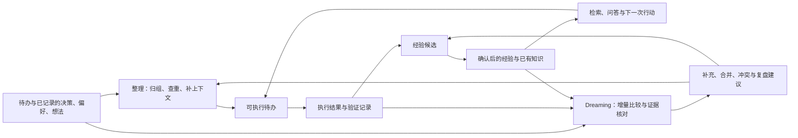

# 待办整理、Memory 沉淀与 Dreaming 收敛方案

日期：2026-11-11。状态：方案与设计稿已由用户确认（设计稿 Version 27：「设计稿没问题」），已按 OM1 实现并通过验收（两轮独立评审、全量 check、隔离实跑）；验收结果与限制见本文第 11 节，迭代记录见 `docs/iteration-roadmap.md` 的 IMP-191 与本文第 11 节。

## 1. 推荐方向

把三件事连接成一个循环：整理出可执行的下一步，保留执行后的经验，再用新经验校正已有知识与后续待办。

- **待办整理**回答「接下来做什么，哪些事项其实在说同一件事」。
- **Memory 沉淀**回答「以后遇到类似情况，应该找回什么，依据在哪里」。
- **Dreaming**是后台增量整理过程，负责发现重复、补充、矛盾与可能的经验；产出有限的变更建议，并有明确停止条件。

Memory 是统一读取与组织方式，现有决策、偏好、想法和原则继续各自存储。建议只补一种当前缺失的内容：**执行经验**，保存一次行动的背景、做法、观察结果、验证方式和适用边界。

默认自动完成分组、检索、候选生成和过期检查；改动用户承诺、原意、偏好或已采纳原则时，展示具体变更后再应用。用户已明确说「记住这条」或有适用的长期指令时，沿用已有记录入口，无需再经过一轮候选审批。

图中的循环跨真实行动推进；同一轮 dreaming 不反复消化自己的输出。

## 2. 已有基础与真实缺口

| 领域 | 仓库现状 | 本次新增的职责 |
| --- | --- | --- |
| 待办 | `TodoService` 统一 App 与 MCP 写入；支持四种状态、P0–P3、期限、标签、跨清单移动、人工处置备注 | 跨清单整理建议、相似事项分组、上下文补充、完成后经验入口 |
| 待办来源 | 清单有项目与客户端；事项用清单 ID 和编号识别；处理记录只在本机 | 给整理与经验保留可核对的事项版本和来源，不能依赖标题或会被裁剪的历史 |
| 知识 | 决策、历史沉淀、偏好、想法已有检索；增补、改写与撤回已有旁路修订 | 在现有来源上给出候选变更，增加执行经验的读取与检索 |
| 方法论 | 已有完整复盘分组、候选提炼、质量判断、合并、修订与搁置 | Dreaming 复用这些入口；执行经验接入原则证据是后续独立扩展 |
| 模型 | 本机 embedding、结构化生成网关、模型调用记录与网络策略 | 复用现有路径；增加有预算、可取消、低优先级的整理作业 |

需要保留的现行边界：

1. 待办完成或放弃必须有实际依据，不能为了让清单好看而改变状态。
2. 偏好来自用户明确表达；重复行为、任务处置备注和模型建议都不能自行变成长期偏好。
3. 想法没有形成承诺，不能静默变成待办。
4. `MethodologyService.generate()` 当前仅接受有实际结果、复盘结论与复盘日期的决策。任务完成说明不是这种证据。
5. 待办处理历史是本机数据且有数量上限，长期清单满时还会腾出已处理项；经验不能只存一个指向历史数组下标的链接。

## 3. 待办怎么整理

入口是待办页的「整理」，支持当前清单、选中事项和当前项目。默认只检查未完成事项，再按需读相关已完成记录和知识；跨项目的相似内容仅提示关联，不默认合并。

| 发现 | 呈现与建议 | 应用边界 |
| --- | --- | --- |
| 多份调研重复提到同一问题 | 一个主题组，逐项列出差异、来源和现有状态 | 首版只做可展开的视图分组，保留每个事项及编号 |
| 事项混合多个行动，或只写了模糊方向 | 给出拆分/改写草稿，并说明缺少哪个验收条件 | 用户采纳才新建或改写；保留原事项到子项的来源关系 |
| 有相关决策、限制或人工意见 | 提示「开始前要看」；带现行版本、范围和例外 | 不覆盖人工处置备注，不把引用变成新的指令 |
| 长期不动、逾期或存在已完成的相似事项 | 提示「需要重新判断」，给出依据 | 不自动延期、完成、放弃；已完成的相似事项不证明本项完成 |
| 有明确优先级和期限 | 按显式优先级、期限和当前进度排列，提供少量下一步 | 模型推测的紧迫性单列为建议，不直接写 P0/P1 或截止日期 |
| 只有可能性、问题或背景材料 | 建议保留为想法/补充资料 | 转换需要明确采纳，不能同时悄悄删除原项 |

**第一版的收敛发生在阅读层。** 两条「修复重复发送」可以在一个主题组里处理，但不能仅因文字相似就合并承诺、丢弃范围或抹掉责任。需要真正合并事项时，后续再加入独立操作：逐字段预览、保留代表项、记录来源别名、处理原项状态，并提供带版本检查的恢复。不能把现有「移到其它清单」当作合并事务使用。

等待依赖、需要澄清等先作为整理建议的原因显示，不扩张待办的四种持久状态；首版也不实现完整项目排期或依赖图。

## 4. Memory 沉淀什么

| 内容 | 保存位置/类型 | 可靠性含义 |
| --- | --- | --- |
| 用户明确说的取舍偏好 | 现有偏好记录 | 用户当前立场，有范围、例外和修订 |
| 已经作出的选择 | 现有决策记录 | 当时发生的选择，不证明后来有效 |
| 尚未确认的观察、假设 | 现有想法记录；模型推测先留在整理候选里 | 不作为用户已承诺的方向 |
| 一次具体行动及其结果 | 新增执行经验记录 | 一次有来源的案例，不能扩大为通用规律 |
| 经过复盘与采纳的可复用规则 | 现有原则 | 保留适用条件、反例和证据；继续走方法论生命周期 |

不把「已确认」设计成一个包办所有含义的布尔值。**谁说的、是否核验、是否采纳、现在是否适用**是不同维度。例如「Agent 报告测试通过」可以被忠实记下，但若没有检验材料，仍标为「Agent 报告，未独立核验」。

一条执行经验的最小内容：

- **场景**：项目、问题、相关版本或时间，以及当时条件。
- **行动**：做了什么，涉及哪些待办和决策。
- **观察**：实际结果和验证方式；失败、混合结果也能沉淀。
- **解释**：模型或用户归纳出的启示，与观察分开；条件与例外不可省略。
- **来源**：清单 ID、事项编号、源内容哈希、必要的结果摘录、报告者及生成者。
- **状态**：候选/已采纳/已归档，来源有效性单独标识；带修订号。

这里的「已采纳经验」只表示愿意保存供以后参考，不等于已经验证因果关系。无需强制每个完成事项产出经验：一般性勾选、没有观察结果的完成、纯事务动作通常不沉淀。

### 读取时怎样发挥作用

优先复用 `search_decision_context` 的关键词/语义检索、范围判断和修订视图，新增显式的经验来源。旧客户端默认来源集合保持兼容。

- 查询时先核对作用域、撤回/归档与来源版本，再做相似度排序和结果去重。
- 展示「当前结论 + 适用条件 + 来源 + 未确定事项」；不要只提供一个没有边界的压缩摘要。
- 候选不进入默认正式知识检索；需要看候选时显式选择，并持续保留候选标签。
- 被打开或被检索多次可以影响展示排序，不能增加事实可信度；只有新观察、用户更正或真实复盘能改变证据。
- 同一事件的原记录、转述、导入副本和生成摘要共用来源血缘，不计作多份独立验证。
- 项目间可提示可迁移经验；范围未知时标「需核对」，不能把项目例外变成全局规则。

## 5. Dreaming 如何运行并停止

推荐采用**确定性筛选 → 有界模型归纳 → 确定性校验 → 建议队列**。模型只获得选定材料，不获得修改笔记、执行任务、访问 shell 或自由联网的工具。材料中的指令按引用处理。

### 一轮过程

1. **选择增量**：读上次游标之后新增或修改的记录，以及被它们影响的旧记录。源内容、有效增补、修订、关系和状态一起组成输入版本。
2. **读取快照**：保存本轮范围、覆盖情况、来源版本和模型/提示词版本。分页完成情况必须记录；少读或读失败不等于来源消失。
3. **生成候选组**：按项目和主题缩小范围，用现有文本规则和本机 embedding 找相似项，补读组内可能的反例与相反结论。相似度只用于召回。
4. **每组归纳一次**：让模型判断内容是重复、互补、范围不同、可能冲突，还是有经验可沉淀；返回结构化建议和支持/反对的源引用。允许「无建议」。
5. **程序核对**：引用必须真实存在；当前版本必须吻合；禁止候选冒充事实、循环证据、越过权限或修改人工处置备注。无法核验则阻止应用。
6. **去重入队**：同一建议更新原候选，不另建卡片；应用、拒绝、稍后的状态持久保存。
7. **发布摘要后停止**：只显示少量当前最有用的建议。剩余批次保留游标；预算用完显示「本轮部分完成」，不报「已全部整理」。

### 真正的收敛规则

| 条件 | 处理 |
| --- | --- |
| 输入版本没有改变 | 不再调用模型，相同输入第二次运行产生 0 条新增建议 |
| 两次建议只是换了措辞 | 由建议类型、目标、作用域、根来源集合认作同一条；文本不作为唯一身份 |
| 一个摘要引用另一个摘要 | 展开到根来源后计算证据，不产生新的独立支持 |
| 反复从 A 改到 B、又建议改回 A | 同一组来源与处理回执阻止往返；没有新事实就维持当前状态 |
| 用户拒绝过 | 同一问题不因模型/提示词升级重新出现；只有新增实质证据或用户主动重开才重新评估，写明变化 |
| 用户选择「稍后」 | 到用户选定的时间再显示，不每日重生成 |
| 出现相反结论 | 先查适用范围和时间；无法解释时保留双方，提交冲突，不按最新时间强行选一个 |
| 来源在后台处理期间改变、撤回或删除 | 候选失效、清除相关缓存并停止应用；重读相关部分，不能复活已删除内容 |
| 原记录无法完整读取 | 显示覆盖不全；冻结依赖该来源的应用与清理，保留可安全展示的其它建议 |
| 本轮生成了新的摘要或候选 | 不把它们当成新事实重新触发本轮，不触发自我扩写 |

因此这里的「收敛」是：**相同材料不会制造更多条目，新的证据优先修订已有理解，未解决的矛盾被明确保留，正式知识可恢复。** 条目总数减少不是唯一目标，不能为缩短摘要丢掉例外或反证。

### 调度与预算

第一阶段只提供手动「整理一次」，先验证效果；第二阶段由用户开启后台整理后，在 App 运行且空闲时增量执行。不要假设 App 退出、电脑睡眠时仍会运行；下次启动从检查点继续。前台采集、检索与问答优先，后台任务可取消。

用于试验的初始上限：一轮最多检查 50 条变化记录、处理 5 个候选组，每组一次生成、每组最多 10 条输入记录，整轮最多 12,000 输入 token、3,000 输出 token 和 120 秒。任一额度先到就停止，失败调用也计入调用预算；底层重试/fallback 必须受同一预算约束。这些是待隔离实跑校准的参数，不是已验证能力或产品承诺。

按预算保留原始短摘录与条件，不能静默截断关键例外后继续做强结论。超出容量的组延后或明确标为部分覆盖。首屏最多展示 5 条建议不等于只处理或只统计 5 条。

归纳走现有 `ProfiledModelGateway`，不另装 agent 框架或向量库。手动运行使用当次选定的生成模型；自动运行须启用对应后台用途，并沿用数据与网络设置。云端模型不可用时暂停，不绕过现有代理策略，也不静默改用另一类后端。

## 6. 自动应用与人工审阅

| 动作 | 默认行为 |
| --- | --- |
| 建索引、分组、重建派生摘要、候选去重、标记来源过期 | 自动；可重建、不改变原记录 |
| 用户明确要求新增/增补的事实 | 沿用当前主动记录与增补流程，不再次确认；必须有真实授权依据 |
| 模型从行动结果提炼经验 | 自动建候选，用户可批量检查并采纳；标明模型整理与报告来源 |
| 合并/拆分待办、改变优先级和期限、建议放弃事项 | 展示影响和变更后应用；不能用「整理」代替完成证据 |
| 改写偏好、确认冲突/替代关系、采纳或修订原则 | 复用现有具体审阅与版本检查，不伪造 `user_confirmed` |
| 删除源记录、发布实践资产、执行待办、修改客户端规则 | 不属于 dreaming 的应用动作 |

批量审阅可以一次接受多项已看过的独立变更，无须逐条对话确认。一个候选若涉及多条互相依赖的写入，应作为一组操作；不把执行了一半的结果显示为全部成功。

## 7. 数据与实现范围

推荐只新增两个持久概念：**整理建议**与**执行经验**。调度记录是本机运行状态，Memory 检索视图可以重建。

### 整理建议

最小字段：稳定 ID、建议类型、目标引用、作用域、根来源集合、输入版本、操作前后内容、理由、反证、模型来源、处理状态、处理回执和应用结果。

- 稳定建议身份与输入版本分离：新证据修订同一个建议，不制造重复卡片；拒绝记录不能因模型换版本失效。
- 候选、游标、拒绝/稍后状态与应用日志保存在 App 本机，沿用现有本地历史和原子写入模式。它们不能全部从 Markdown 重建，备份文档需覆盖。
- 一次应用绑定具体候选修订与所有相关源版本。应用前重新读取；Obsidian 外部编辑不一定增加 App revision，所以不能只检查 revision。
- 已有修订服务用于知识变更，`TodoService` 用于待办变更。复用它们的校验，同时补齐建议依赖的完整字段版本检查；不直接批量写 Markdown 绕过领域服务。
- 操作日志记录「准备、已写目标、已记录回执」等必要阶段，重复提交不重复新建；进程中断后按实际结果恢复。跨文件不能承诺天然原子性。
- 撤销只在应用后的版本仍匹配时恢复；发生后续编辑就生成恢复差异，避免撤销覆盖新改动。

### 执行经验

已采纳经验建议写成 `Decision Journal/experiences/<年>/<月>/…md`，保留稳定 ID 和必要出处。候选留在本机，避免把模型批量推测同步进用户知识库。

经验只摘录支撑结论必需的结果，不复制整份待办历史；这份摘录属于独立采纳的经验内容，不改变「处理记录只存在本机」的现行规则。历史尚未生成候选就已被裁剪时，报告证据不足，不能从 `done` 反推出验证过程。

事项移动会换清单与编号：候选应用前若原引用消失就失效并重读；已采纳经验保存当时出处与摘录，不要求靠移动历史永久追踪。首版不做全量事项 ID 迁移。

删除和撤回需要同时检查经验与候选引用。普通归档保留历史；普通源删除按预览清理机器派生内容，保留用户已经确认的独立选择。显式要求遗忘相关内容时，预览仍覆盖关联的选择、派生经验、候选摘录、缓存与向量，不能依靠「来源快照」保留被要求遗忘的正文。源暂时不可读与真正删除必须区分。

### 涉及的现有代码边界

| 范围 | 现有入口 | 需要的变化 |
| --- | --- | --- |
| 待办 | `packages/core/src/todo.ts`、`packages/storage/src/todo-list.ts`、`todo-history.ts`、`apps/desktop/src/main/todo-service.ts` | 生成稳定来源版本，接入写后失效通知；应用建议继续经过现有写入口 |
| 经验 | `packages/core`、`packages/protocol`、`packages/storage` 的现有分层 | 新的经验类型、Markdown 读写与来源校验，保持旧数据可读 |
| 整理 | `apps/desktop/src/main` | 小型整理服务与本机候选存储；不构造通用工作流平台 |
| 修订与关系 | `decision-context-amendments.ts`、现有范围/关系服务 | 读取当前有效视图；使用已有修订入口并保存应用回执 |
| 检索与模型 | `decision-context-service.ts`、`semantic-search-service.ts`、`model/profiled-model-gateway.ts` | 显式经验来源、结果类型与预算；接入现有来源失效与网络策略 |
| 原则 | `methodology-service.ts`、`packages/core/src/methodology-suggestion.ts`、`methodology-suggestion-preference-store.ts` | 复用已复盘决策路径；首版不放宽证据门槛 |
| 生命周期 | `decision-deletion-service.ts`、原有删除/撤回/归档入口 | 扩展引用预览与派生内容清理，不形成遗忘漏洞 |
| App 与 MCP | 待办/知识页面、主进程路由、preload、bridge、协议导出 | App 先开放审阅；MCP 先扩展读取经验，不直接开放自动批量应用 |
| 验证和说明 | 同领域测试、`scripts/lab`、示例数据、专题文档 | 补数据迁移、来源断裂、并发与闭环案例；README 仅在备份说明变化时同步中英文 |

## 8. 界面方案与设计顺序

已只读查看并截取本机待办页面：左侧清单/视图、中间事项、右侧详情。沿用它的列表和详情结构，不增加主导航页。

建议待办页增加「整理」入口，知识页也可打开同一个整理面板并切到相应范围。面板内按「待办整理 / 记忆沉淀 / 冲突复核」筛选，同一候选只有一份处理状态。方法论入口继续进入其原有候选流程。

每条建议先回答：**发现了什么、为什么现在提示、采纳后会改什么**。详情展示源记录、条件与反证、变更前后；操作是「采纳所选」「编辑后采纳」「稍后」「不采纳」。过期候选保留草稿供参考，但禁止直接应用。后台完成只更新入口摘要，不弹窗打断。

运行状态要能区分：等待空闲、整理中、部分完成、没有新增建议、失败，以及等待审阅；「0 条建议」不是运行失败。

后续高保真稿放在统一设计稿的新增 page「整理与记忆」：
https://claude.ai/artifact/CsaWzJMXPFhNHPNEGJuw23

方案探索时浏览器打开该链接遇到登录页。用户随后要求用 Herdr 委派 Claude 绘图，已通过 Claude 的 Artifact 工具直接更新同一原稿，无需登录。2026-11-11 保存为 Version 27，复用空白 Page 3 并改名「整理与记忆」（page ID：`page-hj2gn3`），包含待办整理、经验沉淀、冲突复核、后台整理状态与设置、来源变化五张画板。远端配置已回读核对，原有「待办」6 张和「知识」3 张的画板配置与便签保持不变。

五张画板已在本机浏览器渲染并逐张检查，修正了底部裁切、待审阅计数不一致，以及将来源版本有效误写成当前适用的问题。（以上是设计阶段的记录。）交付时是静态设计，没有检查编辑器里的缩略图和页面切换。之后用户已确认设计稿（「设计稿没问题」），现已按它实现并通过验收。

视觉沿用 `apps/desktop/src/renderer/styles.css`：`--t-base` 12px、`--t-title` 17px、`--control-height` 28px、`--r-md` 6px、现有主/次/文字按钮、主题行动色与状态色。键盘访问、焦点、来源标签与差异文字不能仅靠颜色表达。

## 9. 分步落地与验收

| 阶段 | 可交付行为 | 暂不承担 |
| --- | --- | --- |
| A：手动待办整理 | 当前项目/清单查重分组、关联知识、版本化建议、拒绝/稍后与重复运行去重 | 自动合并删除、任务执行、全量后台扫描 |
| B：执行经验沉淀 | 从有结果的事项形成经验候选，采纳、检索、修订与来源失效闭环 | 把经验自动晋升原则、任意用户画像抽取 |
| C：后台 dreaming | 增量调度、预算、取消恢复、跨记录冲突与补充建议；复用完整复盘提炼入口 | 自动发布技能、无人审阅地改写正式知识 |

每一阶段都要能独立使用。A、B 验证了建议有用且不会反复出现，再开启 C，避免先建调度器、再每天生成没有价值的内容。

最低验收集：

1. 同一批输入运行两次，第二次没有新增候选与生成调用；换模型也不能绕过拒绝记录。
2. 原决策加三份转述，独立证据仍为一份；存在反例时保留反例。
3. 两个项目采用不同实现，保留各自范围，不归纳为全局偏好或错误地认作替代关系。
4. 用户一项任务的处置备注不会变成长期偏好；未承诺的想法不变待办。
5. 仅有完成勾选或「已处理」说明时，不产出「方案已验证有效」的正式知识。
6. 用户拒绝或稍后处理的建议按其选择保持；实质新证据出现时说明重开原因。
7. 生成后 Obsidian 改文、事项移动、来源撤回或删除，应用会冲突并保留用户当前内容。
8. 模型失败、预算耗尽、覆盖不全、磁盘写入失败、应用中途退出均可恢复，不能把部分成功报成全部成功。
9. 明确遗忘后，候选、缓存和衍生内容不会把正文重新召回；历史裁剪不会让一条经验伪装成已重新核验。
10. 用留出的任务检查：关联证据找回是否改善、误合并/误泛化是否减少、用户处理建议所花时间与调用成本是否合理。阈值依据隔离实跑结果确定，不预先虚报收益。

实现后的实跑一律依照 `.claude/skills/decision-lab/SKILL.md` 与 `scripts/lab/isolated-app.mjs`，使用隔离数据。若组织多模型实跑，按该流程使用 Herdr。不得在真实用户库里批量跑整理来验证算法。

## 10. 取舍与参考

- **推荐统一 Memory 视图并新增执行经验**：保留现有语义和写入口。新增通用 memory 大表虽可快速存一切，但会造成同一偏好/决策两处维护；完全不加经验类型又无法诚实表达「做了什么、结果怎样」。
- **推荐先手动、再后台**：先能观察建议质量、成本与回退，再让它无人值守运行。后台是调度方式，不应改变知识采纳权限。
- **推荐视图分组先行**：能减少重复阅读，又不提前引入事项合并和引用迁移事务。后续真正合并须作为独立功能验收。

参考仅用于架构启发，不表示 Paraself 已获得对应效果：

- [Letta：Sleep-time Compute](https://www.letta.com/blog/sleep-time-compute/) 将上下文整理移到交互之外，并把记忆维护与前台任务解耦。本方案采用后台整理这一思路，额外规定候选审阅与来源版本校验。
- [LangMem：Core Concepts](https://langchain-ai.github.io/langmem/concepts/conceptual_guide/) 区分事实、经历和程序性知识，并讨论前台与后台形成记忆。本方案据此区分执行经验与原则，具体类型和权限仍以 Paraself 的领域约束为准。

本轮产出为这份提案与原稿中的「整理与记忆」设计页，没有改变运行逻辑、正式决策、用户待办或记忆，没有运行产品模型效果实验、测试或构建安装。

## 11. 确认之后：实现采用的机制与验收结果

用户确认设计稿后进入实现（OM1）。实现前做了架构评审，评审要求的修正都已写进代码与测试。下面列出实现采用的机制、验收结果和已知限制。

### 借鉴的官方机制

参考了以下资料。每一条都只借鉴机制，不表示 Paraself 已获得对应效果，也没有接入这些服务：

- **Codex Memories**（https://learn.chatgpt.com/docs/customization/memories）：「逐会话提取」与「全局收敛」分成两步，后台处理，额度不足时可以跳过，生成和使用分开控制。对应到这里：先逐来源提取经验候选，再按组做跨来源收敛；额度用完时本轮记为部分完成；生成由手动整理和后台开关控制，经验只在请求显式指定 `experiences` 来源时才被检索，与生成互不依赖。没有单独的「使用记忆」全局开关。本机 Codex CLI 的 memories 功能并未开启，这里不作此声明。
- **Claude Code memory**（https://code.claude.com/docs/en/memory）：短索引加按需读取的主题内容；记录反馈、项目背景和外部资料的位置，不重复代码里能直接查到的事实；按项目共享，而不是所有场景全局通用。对应到这里：经验按项目归属，项目未知时标「需核对」；只沉淀难以重新获得、带出处的行动结果。
- **Claude Managed Agents Dreams**（https://platform.claude.com/docs/en/managed-agents/dreams）与官方示例（https://platform.claude.com/cookbook/managed-agents-cma-dreaming-with-a-dynamic-workflow）：输入不改，输出放到独立位置供审阅后采用；异步作业可以取消、可以失败；先逐来源分析，最后统一整理，工作会话只读使用。对应到这里：建议另存为候选，采纳要经过用户；后台可取消，取消后迟到的结果直接丢弃。**没有照搬**示例中无需审阅、原地更新的做法。

据此定下的规矩：归纳出来的内容一律先作为候选；正式检索与后台整理分开；同一材料反复摘要不会提高它的可信度（证据按血缘根计数）。

### 已落进代码

- 两份持久数据、建议的稳定身份与承接规则、两种指纹、拒绝后不复活、相同输入第二次运行不调用模型。
- 写目标前先落盘计划，写前写后各核对一次依赖，经验从 pending 到 active 两步启用，撤销前先给出差异。
- 失效、冻结、清除与遗忘分开处理。OM1 曾将决策删除联动为广义遗忘；2026-11-15 按用户新要求修正为普通源删除保留已确认的独立选择，显式遗忘仍可清除它们，两种范围分别绑定预览哈希。经验笔记在外部被删时仍做派生清理。
- 显式检索 experiences，并且旧版本 bridge 保持兼容。
- 预算与用量记账分开记报告值和估算值；后台默认关闭，空闲时运行，遇到前台活动立即让行。
- **已采纳之后的新证据**：经验或分组采纳后，来源又有实质变化（补了更正、加了同组的新事项），再整理时会生成一张「修订」卡，id 为 `<原卡 id>~r<原证据版本>`，走现有的审阅流程：卡上由程序写明修订的是哪条、采纳后会改什么、哪些不变以及撤销后的结果。采纳经验修订时，按新内容写一条新经验并启用，再把旧经验改为已归档（只改状态，正文保留不动），这一步绑定采纳时留下的笔记哈希，旧笔记在外部被改过就拒绝采纳、什么都不写；撤销时删去新版，旧版恢复为启用。分组修订采纳后，待办页只显示新分组；撤销后旧分组重新显示。在采纳之前，原记录不会被改动。同一份新证据反复整理只会对应一张修订卡，拒绝之后证据不变就不再出现。没有新做页面，也不迁移历史数据。
- **别名不外露**：提示词里给事项和记录用的别名（T1、K1），出现在模型写的说明文字里时，替换成对应的标题。

### 实跑结果（2026-11-11，隔离打包 App，合成数据，无真实凭据）

走的是页面的真实 IPC（经 CDP 调 `window.decision`）和 bridge MCP，**没有点按钮**；按钮与截图由界面实现者另行覆盖。

- **桩模型闭环**（`scripts/lab/probes/organize-run.mjs`，本机 OpenAI 兼容桩，输出固定）：33 项全过（r8、r9、r10，最后一次是含修订卡与别名修复的构建）。覆盖：整理、同输入零调用、采纳分组与验收草稿、撤销、删除事项后清除、暂停与停止后迟到的结果不写入、杀进程后记为中断且队列保留、后台首次自己发现新记录、后台遇到 agent 检索 24 ms 内让行、状态文件损坏时拒绝写入。
- **实跑中发现并修掉的产品问题**：r7 时后台 29 轮全部暂停、零调用。原因是页面刷新本身触发了 IPC 活动钩子，后台因此反复给自己让行。改法：去掉 IPC 钩子，后台运行期间每秒检查一次系统空闲时间，再加上前台模型调用与本机 HTTP 请求两路信号。
- **本机 Qwen 3.5 4B 小样本**（`scripts/lab/probes/organize-qwen-run.mjs`，只读链接本机模型权重，串行跑 3 轮；这部分只说明模型的实际产出，不套用桩的通过率）：
  - 内置配置原样（超时 5 秒）可用：首轮含模型加载约 19–21 秒，2–3 次调用，失败 0 次；报告用量为输入约 0.8–1.1k、输出约 0.6–0.7k token。
  - 产出：完成事项的 agent 结果说明被提成一条经验，五节齐全，标为「Agent 报告，未独立核验」，例外写了「手动重发未验证」；只写「已处理」的完成事项没有被提成经验；两条说同一件事的未完成事项归为一组。缺少完成标准的未完成事项，这次 3 轮都**没有产出**验收草稿（桩会生成）。样本太少，判断不了是模型能力不够，还是提示词或输入的问题。
  - 补了一条更正（网络切换时又复现）再整理：约 2.5 秒、1 次调用，生成一张修订卡，内容把更正并了进去，结果改为「partial」，例外里加了「幂等键是否持久化未验证」；已采纳的旧经验没有被改动。
  - 早几轮的分组说明里出现了「T1 是…，T2 是…」，读者看不懂指的是哪条；加了替换之后，q3 显示为事项标题。
  - 真实调用途中点停止：5 ms 内收到答复，9 ms 后本轮记为 stopped。驱动无法确认按停止的那一刻调用是否已经发出，因此提示词读入阶段的最坏停止时延，仍以集成前的单独测量为准（约 2.6k 字提示词为 1.9–3.1 秒）。
  - 样本只有一个合成项目、三轮，**不作质量或收益承诺**；误合并、误泛化需要用留出的真实任务另行评估。

### 验收

- 独立评审两轮，评审意见全部修复并附复现测试；新增的修订路径和归档恢复守卫另做了定向复验（正常恢复、外部改正文、外部加一行、缺少 afterHash、尚未写入，五种场景）。
- 全量 check：384 个文件，6,745 项测试通过，8 项跳过。归档恢复守卫的修复在这次之后，用相关的聚焦测试（168 项）和类型检查覆盖。
- **归档恢复守卫**：归档旧经验之前，先把这次要写成的整篇笔记的 hash 落盘。中断后恢复时，只有笔记与它逐字一致才算已写入；正文或额外文字被外部改过的，都记为冲突，不补回执，也不会被撤销重新启用。

### 已知限制

- 界面上，修订卡沿用现有卡片：原因显示在「重新出现：」那一栏，「采纳后会改」「不会改」两栏写的是程序生成的说明。是否要单独的「修订」标签，需要先在设计稿里画出来再定。
- 首版不做：真正合并或删除事项、自动执行待办、自动采纳原则、发布技能。

## 12. 自动维护导向的修订提案（2026-11-11，未实施）

用户在 OM1 交付后指出：整理范围不应被待办事项限制，首页的待处理等也应纳入；内容持续增长，用户没有精力主动启动整理并逐条采纳。此节是对已交付版本的后续提案，不表示现有 App 已具备这些行为，也不是用户已批准的详细实现方案。

### 当前版本的偏差

现有整理会读取待办、已记录决策、历史沉淀、偏好、想法与经验；首页的待确认、待补理由和需复盘队列尚未成为完整的整理输入。后台开关虽然能自动生成候选，但候选的采纳与修订仍依赖用户。因此只是部分操作自动化，没有解决用户注意力随内容量增长而耗尽的问题。

应把目标调整为：持续维护全部已授权内容，使有用记忆自动可用，把需要用户判断的问题减少到少数例外。新增多少候选、清空多少卡片不作为成功标准。

### 官方流程的实际边界

- [Codex 本地记忆](https://learn.chatgpt.com/docs/customization/memories)：启用后在后台从符合条件的会话生成和更新记忆，跳过仍活跃或过短的会话；不是每条记忆都需要用户点采纳。开关、来源与配额控制是配置层面的介入。
- [Claude Code Auto memory](https://code.claude.com/docs/en/memory)：本地会话默认启用，由 Claude 自己选择值得记住的反馈、项目背景等，并读写记忆文件；用户可查看、纠正和关闭，并非日常逐条审批。
- [Managed Agents Dreams](https://platform.claude.com/docs/en/managed-agents/dreams)：异步产出独立记忆库，文档提供检查后启用输出的流程；它不是无需接线就会自动运行的 Claude Code 开关。开发者负责触发与使用输出。[官方自动运行示例](https://platform.claude.com/cookbook/managed-agents-cma-dreaming-with-a-dynamic-workflow) 展示了夜间增量整理及后续会话读取，可以由工作流完成。不能把“结果可检查”一概变成“终端用户必须逐条审批”。

### 建议分开维护三类内容

| 内容 | 建议行为 |
| --- | --- |
| 原始记录与用户明确表达 | 保留原话、作者、来源与版本。明确表达的选择和偏好可以直接按现有授权记录，不再重复确认 |
| 机器整理的记忆 | 自动提取、去重、关联、压缩与修订，经过来源/范围/冲突检查后可用于检索；持续标明推断、报告者与未核验状态，支持追溯、纠正和回退 |
| 真正需要用户判断的问题 | 仅当证据不足且会影响当前行动、用户承诺或重要选择时进入注意力列表；可以暂不处理，不要求清空 |

自动可用不代表用户已经认可，也不代表已经验证。把这个区别写进数据和检索结果，就不必用人工采纳守住每一条机器记忆。人的原始记录仍有独立的确认与修订语义。

### 全部待处理也进入自动分诊

| 来源 | 自动做什么 | 留给人的边界 |
| --- | --- | --- |
| 待确认的采集 | 关联后续会话、识别重复和被后续明确回答的问题、按主题归组 | 未作出的选择保持未决，不猜用户已经选了什么 |
| 待补理由 | 从已授权记录找已有理由，保留明确出处；缺少理由也能保留已发生的选择 | 推断出的解释单独标识，不填成用户亲口说的理由；不为每条历史记录追问 |
| 需复盘 | 汇集已有结果与相关事件，产生机器复盘、更新适用性提示 | 没有结果就标未知，不编造成功；只提醒值得补充且影响当前工作的事项 |
| 待办、想法 | 自动分组、关联上下文、追踪已有完成证据与后续变化 | 整理不虚构完成，不把可能性当成承诺；变更承诺需要明确依据 |
| 决策、偏好、经验、原则 | 统一参与范围核对、关联与机器记忆收敛 | 推断不冒充用户偏好或已采纳原则；明确冲突保留双方及条件 |

只处理已采集或明确接入授权的内容，不借扩大整理范围新增无边界监听。

### 自动运行与减少打扰

推荐首次设置好范围、模型和预算后持续增量运行。内容变化触发待处理，空闲时收敛；没有变化不重复调用；失败保持检查点，不丢来源。具体安排需在后续实现中验证，不能只换一个默认开关。

- 常规机器记忆整理自动生效，提供“最近自动整理了什么”和回退入口。
- 人工队列保留重要冲突和真正待决事项；证据不足但暂不影响工作的内容安静保留未知状态，不每天催用户。
- 按主题汇总，合并同一问题的多次提示；低价值提醒可以延后或在展示层归档，原始事实和未决状态仍保留。
- “整理一次”保留为查看、补跑和排错入口，日常不要求用户主动点击。
- 衡量减少了多少必要人工操作、找回是否有用、错误是否会传播、纠正是否能生效，以及后台成本；不以生成记忆条数衡量收益。

用户已要求按此方向更新统一设计稿的「整理与记忆」page，设计交付见第 14 节；仍待用户看过后再实现。本轮未改变已安装 App 的开关或数据处理策略。

## 13. OM1 交付与 Herdr 收尾记录

- 功能提交：`d4880957`；纯注释提交：`f43a86c3`。均已合入本地 main，未推远端或发版。
- 合并后的构建、签名检查、smoke、33 项打包 IPC/MCP 验证通过；安装程序返回 healthy=true，安装包与构建包的 app.asar SHA-256 一致：`086adf57bdfee343a2d814227bc84befc968ba2a89d10708acdeb69223ecf0a0`。
- 全量 6,745 项通过、8 项跳过；最后归档恢复守卫另由 168 项聚焦测试和独立复验覆盖。没有把早期失败的实跑当成最终通过。
- 可重复运行的驱动已保留为 `scripts/lab/probes/organize-run.mjs` 和 `scripts/lab/probes/organize-qwen-run.mjs`；设计、边界、修复结论与效果限制保留在本文及 IMP-191。临时实验目录不作为唯一交接资料。
- 待后续决定的方向是第 12 节的自动维护提案；没有继续运行的实现、评审或验证任务需要依赖已完成的 Herdr tab。
- 收尾已执行：核对会话身份和空闲状态后，关闭了本任务的设计、实现、界面与评审四个 tab；专属空工作区随最后一个 tab 关闭而移除。Herdr 的“先沉淀、再关闭”要求已增补到用户已有偏好，并写入本仓库 AGENTS.md。

## 14. OM2 自动维护设计稿交付（2026-11-11；2026-11-13 用户批准实现）

本轮仅调整设计稿，未实施产品改动。按照用户要求，在 Herdr 中启动 Claude（本机默认 Fable 5.2），通过 Artifact 工具修改原稿，不登录、不创建替代文件。

- 原稿：[Paraself 设计](https://claude.ai/artifact/CsaWzJMXPFhNHPNEGJuw23)。最终 Version 30，版本 ID `1794405742-4f6e`。
- 复用原有「整理与记忆」page（`page-hj2gn3`）及五张画板，没有新增同名 page；其它「待办」「知识」页面、九张画板配置、七条便签及全局打开方式保持原样。
- 五张画板依次为：全局自动维护总览；待处理的自动分诊；自动记忆与版本；需要用户判断的问题；自动维护设置与运行状态。

### 本版的核心变化

- 从特定待办清单转向全部已授权内容，包含待确认、待补理由、需复盘，以及待办、决策、历史沉淀、偏好、想法、经验和原则。
- 总览呈现已自动生效的变化与少量待决问题；常规行只有查看、纠正、回退等入口，不再要求逐条采纳。补充了没有待决问题时的正常状态。
- 待处理依据后续明确答复自动关联和归并；缺少理由或结果时保留未知、等待后续证据，不为填空猜测个人理由，也不催用户清空队列。
- 机器记忆自动更新、可供检索，展示适用范围、观察、推断、未知和出处；用户原话与已确认原则另行保留，版本可查看和回退。
- 人工判断示例收敛为一个真正的承诺取舍：按期发布与完成已承诺的修复范围发生冲突。技术方案和资料适用性核验由系统处理；未核验的工期与未知影响保持可见，不凭发生次数判断风险大小。
- 首次选好范围、模型和预算后持续运行；“整理一次”是补跑入口。预算用完、来源暂不可读和模型失败都保留进度与已有记忆，按条件恢复，通常汇总成一条状态。

### 设计检查与范围

- 最终索引正文已从远端回读，与发出的文件相同；五张画板文件也已逐字节核对。其它页面的画板内容在 Version 29 回读时核过哈希，Version 30 未发送这些文件。
- 主会话已查看五张最终全尺寸静态预览。真实 `window.innerWidth/innerHeight = 960×640` 下，页面级溢出为零，五张画板分别有 31/31、25/25、24/24、24/24、42/42 个控件可滚动到达。
- 常规产品界面与零待决、首次开启、异常状态等变体有明确分隔；设计者说明与数量口径放在同页便签中。
- 预览为本机无头 Chrome 渲染的静态 HTML，未核对设计编辑器内的页面切换、便签渲染和完整键盘走查，也没有验证实际后台业务逻辑。全部示例数据为合成数据。
- 最终预览与检查记录已留存；本次没有仍在运行的预览服务。结论保存后，已核对身份并关闭本次唯一的 Herdr 设计 tab，专属空工作区随之移除。用户于 2026-11-13 批准实现，并要求代码全部由 Codex 自行完成。

## 15. OM2 自动维护实现（2026-11-13）

依据 Version 30；本轮代码由 Codex 自行实现，没有委派代码开发或新建 Herdr tab。

### 行为与边界

- 首页、知识、待办共用「整理与记忆」。总览、待处理、记忆、需要你判断、设置与状态五个页签；默认全局查看，可按项目、来源缩小范围，模型关联始终限制在同一项目。
- 来源覆盖待确认、待补理由、需复盘、待办、决策、历史沉淀、偏好、想法、经验、原则。决策的理由、背景、预期与实际结果分开；想法的未决问题、偏好的边界也进入证据指纹。
- 首次明确选择来源、模型和每轮预算后开启。旧版后台生成开关不会自动升级为写入授权；已编辑草稿、回退与拒绝记录继续保留。常规归组、引用关联、执行经验与知识记忆自动写入阅读层或独立记忆笔记。
- 待补理由和复盘缺证据时记为未知或等待，不反复催补。关联已有原话只写分诊和引用，不擅自把原始待确认队列改为用户已确认，不填造理由或业务结果。
- 人工问题须有当前未完成事项或待确认记录，以及可逐字核对的已有用户承诺。仅缺资料、过期、技术算法选择不会由确定性规则创建问题。模型建议保留未知和范围，仍需显式确认选项；确认只记录选择，不执行任务或对外发送。
- 用户确认的选择作为新陈述参与后续整理；机器生成记忆不作为新的独立证据循环提炼。普通知识记忆的观察只允许引用本轮完整读到的连续原文，归纳与未知另列。模型的业务判断仍属于建议，不是事实证明。
- 来源变更或暂不可读时暂停相关记忆召回，保留笔记和版本，恢复后重新检查。新证据修订、用户纠正及回退沿用写前计划、版本核对和恢复机制；版本使用独立的前版引用，标识不会随修订次数不断增长。
- 遗忘沿来源血缘清理分诊、派生记忆、模型调用和向量；保留哈希回执，同一份材料不会在下一轮恢复。真正的新证据可重新处理。
- 每轮预算、未完成队列和实际用量继续保存。仅 App 运行且空闲时处理，前台活动让行；退出或睡眠后等待下次运行。面板优先展示需判断事项与最近 500 条维护记录，较早记忆仍保存在资料库并可检索。

### 数据与兼容

复用 `organization/state.json` 和 `Decision Journal/experiences/`，没有另建一份通用知识数据库。新增设置、来源、分诊、问题及前版引用采用兼容读取；旧版记录保持可读。机器知识记忆使用 `machine_synthesis`，未知结果使用 `unknown`；面向旧 shape-3 bridge 的召回仍使用其认识的未核验枚举，另以文字明确机器归纳，不能被说成用户报告。

### 验证记录

- 核心与界面定向回归：112 项通过，含自动启用、个人范围后台、来源授权、跨项目隔离、静默未知、版本纠正/回退、同证据抑制、预算续跑、派生遗忘、连续修订、来源失效与 UI 输入保留。
- 最终打包 App 的确定性隔离实跑：26/26，通过真实 IPC 和 bridge MCP；覆盖三类待处理、归组、知识/经验召回、用户确认、纠正/回退、增量不循环、后台发现新增内容。另实际点击五个页签，在 1440 与 960×640 两个尺寸逐页截图并检查页面溢出。种子和模型输出均为合成样例；这些结果不代表模型泛化准确率。
- 安装包常规隔离 smoke 通过，包括启动、bridge、Markdown/索引恢复、Hook 递归与载荷隐私边界，退出清理成功。
- 首次全量回归出现三处已有时序敏感失败：两处单独复跑通过；另一处在改动前快照也可通过，测试改为等待真正的「重试执行」按钮，避免只等到前一帧的错误消息。最终全量检查 6,746 项通过、8 项跳过。随后补查每轮自动应用上限和写失败恢复，相关 104 项复跑通过，类型检查与 diff 检查通过。待确认材料补查 62 项通过，原问题、候选回答和语义边界保留，会话编号和本机路径不作为知识材料。安装结果在交付时追加。

- 本机真实模型 `qwen3.5-4b-q4-k-m`，使用交付构建与隔离合成数据：首次 22.9 秒、3 次调用、0 次失败，自动启用一条执行经验和一组阅读归组；后续结果更正 5.6 秒、1 次调用，自动启用新版。知识来源已进入 `knowledge` 检查，本样本没有额外生成知识记忆；不据此宣称知识归纳的泛化准确率。中途停止控制响应 5 ms、运行结束 10 ms，仅为此次机器负载下的小样本观测。模型读取仅使用已有权重，未使用真实业务笔记。
- 合入 main 后构建的确定性实跑再次 26/26；常规 smoke 和深度签名检查通过。自动写入受每轮变更/时间上限约束，写入失败报告部分完成并保留重试步骤；最后相关回归 104 项通过。

- 升级授权边界追加复核：旧版后台配置只继续使用原先六类来源；待确认、待补理由、需复盘、原则须在首次自动维护配置或显式来源选择后才送入模型。类型检查通过，相关 74 项测试通过。

### 最终交付与收尾

- 实现与修正均已快进合入本机 main，最终产品代码提交 `a7934a24`。主检出的依赖目录是链接，因此用独立依赖的工作树构建相同提交。构建下载出现连接中断后，使用项目已有 `PARASELF_ELECTRON_ZIP_DIR` 入口读取本机 Electron 43.2.0 缓存，未改依赖版本；缓存完整性、最终包深度签名与 smoke 均通过。
- 最终包隔离实跑再次 26/26，升级授权边界 74 项、暂停配置 12 项定向检查通过。暂停只关闭后台，不提交表单中尚未确认的来源、模型或预算。
- 本机安装、重启及健康检查完成，安装内容与交付包一致。最终 `app.asar` SHA-256：`2c8173563750a11c971b156d7ee40547bbd528a41ee2f6cd3daa8c2d2851eeaa`。
- 安装保留现有配置。用户首次在「整理与记忆 → 设置与状态」确认来源、模型和预算后开启新自动维护。
- 截图、实跑报告、本机模型观测、测试日志、安装回执与校验清单已保存到本地交付资料。本轮没有新建 Herdr tab；各轮隔离 App 与 bridge 均完成退出检查。
- 未做长期耐久或大规模数据压力测试。本机模型只有少量合成样本，模型归纳和业务建议仍可能需要用户纠正；产品提供来源、版本和回退，不把推断当作用户已认可的事实。

## 16. 来源生命周期与独立选择（2026-11-15，RSI-015）

| 事件 | 机器派生内容 | 已确认的独立选择 |
| --- | --- | --- |
| 偏好/想法归档、来源撤回 | 保留笔记与版本，暂停作为现行输入；恢复来源后可恢复 | 保留选择事实，不继续把旧机器背景当作用户认可 |
| 来源暂时不可读 | 冻结；不按删除清空草稿/笔记；结果未提交则保留队列重试 | 本身仍可读取时保留 |
| 源文件在外部删除 | 暂停机器后代，清理可确认的失效建议与调用；不擅自改写保留笔记 | 保留 |
| App 内普通决策删除 | 按真实预览联动清理机器派生内容与调用记录 | 保留；已写成生效笔记而欠最终回执的选择仍可恢复 |
| 显式遗忘相关内容 | 按完整来源链和预览清理 | 若在预览中属于遗忘范围，仍会清除 |
| 选择自身归档、删除、遗忘 | 它的机器后代停止作为现行输入 | 尊重选择自身的生命周期；归档历史可显式查看 |

归档已完成的待办清单属于整理历史，不等于撤销已记录的执行观察。人工采纳普通机器经验不等于作出新的独立选择。

新调用单独记录直接输入，完整祖先继续用于来源类别授权和显式遗忘；生命周期在明确确认的选择处停止向上依赖。旧机器产物没有直接输入记录时，保守沿已有完整关系判断，不猜它是否只读过选择原文，也不改写旧历史。确认选择的检索标题、标签与观察以实际确认文字为准，机器问题背景不再当成用户陈述；原始笔记及定位保留。

调用、提交和自动写入前重新核对来源；临时失效的模型结果（包括空回答）不记作完成。恢复后的新证据按实质指纹判断，历史创建日期不变也不会永久阻止重新处理。验证与安装结果见 `docs/rsi-improvement-ledger.md` 的 RSI-10。
